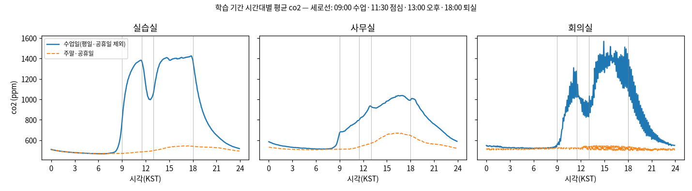
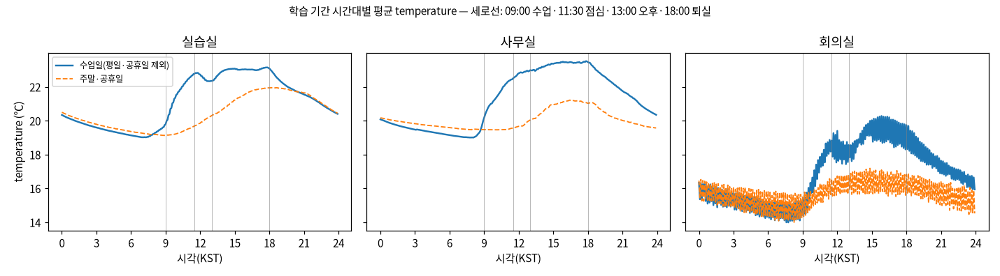
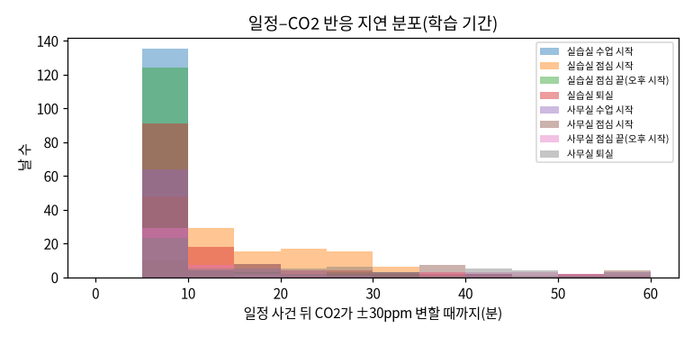

# 과제 2 산출물 ① 데이터 진단서

> **측정 조건**
> - 데이터: 실데이터(MySQL `cf_u36_d3.measurement`). 과거분은 InfluxDB에서 적재한 2025-08-08 ~ 2026-07-22, 실시간분은 2026-10-20 ~이다.
>   원본은 730만 행(CO₂·온도·습도·배터리)이다.
> - 통계 기준: **학습 기간 2025-09-04 ~ 2026-03-31(KST)**. 분할은 `v1-provisional`이고, 과제 3~6의 공식 평가 기준이다.
> - 분석 간격은 5분이다. 공간 대표값은 센서별 5분 평균의 중앙값이다.
> - 설정 `config/analysis.yaml`(규칙 해시 `21fab7296b62`)이다. 실행 환경은 Jetson(aarch64, 전력 모드 기본값)이고, 전체를 다시 만드는 데 220초, 최대 메모리 739MB가 들었다.
> - 다시 만들기: `analysis all`. 숫자 원본은 [진단 상세](../../reports/task2/diagnosis_v1-provisional.md)와 [사건 목록](../../reports/task2/events.md)에 있다.
> - 함께 보는 산출물: [② 기준선 성능표](baseline_v1-provisional.md)

## 0. 한눈에 보기

| # | 발견 | 숫자 | 다음 과제에 주는 의미 |
|---|---|---|---|
| 1 | 실습실 데이터는 거의 완전하다 | 학습 기간 관측 칸 **99.9%**, 센서 오류 0.13%(CO₂) | 과제 3의 주 학습 대상 |
| 2 | 회의실은 10분 주기 센서 1대뿐이다 | 5분 칸의 **49%만 실제 관측** | 5·15분 지평은 평가할 수 없다. 30·60분만 평가한다 |
| 3 | 사무실은 긴 공백이 있다 | 2026-01 중순 ~ 03 중순 수신 없음, 학습 기간 빈 칸 **26.7%** | 학습 표본이 실습실보다 적다 |
| 4 | 일과표 흔적이 뚜렷하다 | 실습실 09:00 수업 시작 뒤 **5분 안에** CO₂ 반응(측정일의 99%) | 시간대·일정 정보가 유용한 입력이다 |
| 5 | 수업 중 공기질이 나쁘다 | 실습실 수업 시간 평균 **1,288ppm**, 1,000ppm 초과 시간 **83%** | 예측은 환기 판단에 실제로 필요하다 |
| 6 | 회의실은 짧고 높게 치솟는다 | 회의 중 최고 **7,029ppm**, 밀집 사건 후보 11건 | 과거값만으로는 예측이 어렵다. 예약 정보가 필요하다 |
| 7 | 값은 몇 분 사이에 거의 변하지 않는다 | 자기상관 5분 **0.999**, 1시간 0.909 | 무작위 분할은 금지한다. "현재값 유지"가 강한 기준선이다 |

---

## 1. 데이터 개요

### 1.1 공간과 장치

| 공간 | 장치(수) | 항목 | 보고 주기 | 원본 행(전체 기간) | 비고 |
|---|---|---|---|---|---|
| 실습실 `lab` | CO₂ 겸용 4대, 온습도 4대 | CO₂·온도·습도 | 60·120·600초 혼재 | CO₂ 84만, 온도·습도 각 85만 | 복도 센서 `…151523`은 진단에만 쓰고 공간 대표값에서는 뺀다 |
| 사무실 `office` | CO₂ 겸용 2대 | CO₂·온도·습도 | 60초 | CO₂ 40만, 온도·습도 각 79만 | `…081175` 배터리 1%(과제 1 장비 현황) |
| 회의실 `meeting` | CO₂ 겸용 1대 | CO₂·온도·습도 | **600초** | 각 4.4만 | 센서 1대라 고장 나면 공간 전체가 비게 된다 |
| 사무실 밖 `office_out` | 온습도 1대 | 온도·습도 | 60초 | 각 40만 | 복도·외기 쪽 기준값 |
| 창고 `storage` | 온습도 1대 | 온도·습도 | 60초 | 각 44만 | 2026-05-10 이후 수신 중단 |
| 개발실·대표실 | 냉난방 실내기 | 온도·습도 | 60·120초 | 각 0.1만 | 2026-10-20부터만 있어 과제 2 분석에서는 뺐다 |

- 기준선 대상 공간은 **실습실·사무실·회의실**이다. CO₂ 센서가 있고 사람이 쓰는 공간이기 때문이다.
- 시각은 과제 1에서 정한 기준 시각(네트워크 서버 수신 시각 `nsTime`)이다. 게이트웨이 시계가 5분 빠른 문제는 이 단계에서 이미 걸러져 있다.

### 1.2 기간

```text
2025-08-08 ─ 08-14 │ 공백 ─ 09-03 │■■■■■■■■■■ 학습 ■■■■■■■■■■│ 04-02 ■ 검증 ■ 05-09 │공백│ 05-27 ■ 시험 ■ 07-22 │ 미적재 │ 10-20 실시간 →
                    (장치 미특정 75만 행)   2025-09-04 ~ 2026-03-31                    05-10~05-26                       (InfluxDB 망 단절)
```

---

## 2. 정제 규칙

### 2.1 원칙: "지우지 않고 표시한다", 그리고 "센서 오류와 실제 사건을 나눈다"

처음 세운 규칙은 "물리적으로 불가능한 값(0ppm, 60℃)은 제거"였다. 그런데 이 규칙에는 문제가 있다.
실내에서 불이 나면 60℃는 **실제로 일어날 수 있는 값**이고, 비가 새면 습도 100%가 이어지는 것도 실제 상황이다.
이런 값을 지우면 가장 중요한 순간이 데이터에서 사라진다. 그래서 판정을 두 축으로 나눴다.

| 축 | 질문 | 판정 근거 | 처리 |
|---|---|---|---|
| **축 A: 센서 오류** | 센서가 **측정해서 낼 수 없는** 값인가? | 값 하나 + 기종 제원(오류 코드, 측정 범위) | `error` 표시. 분석 입력에서만 빼고 원본은 남긴다 |
| **축 B: 실제 사건** | 드물지만 **실제로 일어날 수 있는** 극단 상황인가? | 공간·시간 패턴(여러 센서가 함께, 일정 시간 지속) | 값은 그대로 두고 사건 후보 목록에 올린다(과제 4 입력) |

- 원본 행은 어떤 규칙으로도 지우지 않는다. 검산 결과 ok 7,302,351 + 포화 4 + 오류 1,873 = 원본 7,304,228로 일치했다.
- 축 A 판정에는 기종 정보만 쓰고, 축 B 임계값에는 **학습 기간 통계만** 쓴다. 시험 기간 값으로 임계값을 정하면 평가가 오염되기 때문이다.

### 2.2 축 A: 센서 오류(물리적으로 불가능한 값)

| 규칙 | 내용 | 실측 건수 | 왜 오류인가 |
|---|---|---|---|
| A1 오류 코드 | CO₂ `65535`, `0` | **1,069**(65535 1,067 + 0 2) | 65535는 16비트 최댓값으로, 센서 읽기 실패 코드다. 실내 CO₂가 0ppm일 수는 없다(외기만 해도 약 420ppm) |
| A2 오류 쌍 | 같은 장치에서 1초 안에 습도 `127.5`와 온도 `−0.1`이 함께 나옴 | **402쌍(804행)**, 장치 3대 | 온습도 칩 통신 실패 때 나오는 고정 패턴이다. 과거분은 두 값이 1ms 차이 별도 행으로 저장돼 있어 1초를 허용했다(첫 구현은 83쌍을 놓쳤다) |
| A3 제원 범위 밖 | CO₂ 0~10,000ppm, 온도 −40~85℃, 습도 0~100% 밖 | 0(A1·A2 제외) | 센서가 측정할 수 없는 범위다. 범위를 **넓게** 잡아 화재(60℃)·누수(습도 100%)를 오류로 지우지 않게 했다 |
| A4 포화 | CO₂가 상한 10,000ppm에 정확히 붙음 | 4 | **오류가 아니다.** 실제 농도가 상한을 넘었을 수 있으므로 `saturated`로 표시해 축 B 재료로 남긴다 |

> 처음에는 포화 상한을 5,000ppm으로 잡았다. 그런데 회의실 센서(AM103)가 7,029ppm을 실제로 측정한 기록이 있었다. 그래서 상한을 기종 제원인 10,000으로 고쳤다.

**공간·항목별 오류율(전체 기간)**

| 공간 | CO₂ | 온도 | 습도 |
|---|---|---|---|
| 실습실 | 1,069 / 843,298 (**0.127%**) | 22 (0.003%) | 22 (0.003%) |
| 사무실 | 0 | 0 | 0 |
| 회의실 | 0 | 0 | 0 |
| 사무실 밖 | — | 368 (0.093%) | 368 (0.093%) |
| 창고 | — | 12 (0.003%) | 12 (0.003%) |

- CO₂ 오류 1,069건 중 65535 1,067건은 **실습실의 한 장치**에서 나왔다. A2 오류 쌍도 장치 3대에서만 나왔다. 고장 경향이 장치 단위라는 뜻이므로, 과제 4에서 장치별로 경보 기준을 둘 근거가 된다.

### 2.3 축 B: 실제로 일어날 수 있는 극단 상황

| 규칙 | 판정 조건(설정 `axis_b`) | 학습 기간 기준값 | 실측 |
|---|---|---|---|
| B1 화재 후보 | 같은 공간 센서 **2대 이상**이 30분 안에 온도 +5℃, 습도는 하강 | — | 0건 |
| B2 누수 후보 | 습도 **95% 이상**이 30분 이상 지속 | — | 0건 |
| B3 밀집·환기 부족 | CO₂가 max(학습 p99.9, 2,500ppm)를 넘음. 센서 2대 이상이 함께 넘거나, 1대면 3칸 연속 | 회의실 3,887 / 사무실 2,818 / 실습실 3,024ppm | **14건**(회의실 11, 실습실 2, 사무실 1) |
| B0 단독 극단값(의심) | 한 센서만 자기 편향을 뺀 값이 MAD×10을 벗어남(바닥값 CO₂ 30ppm, 온도 0.3℃, 습도 2%) | 센서별 | 876칸(대부분 실습실 `…152862` 온도) |
| 값 고정 후보 | 2시간 이상 같은 값이고, 같은 공간의 다른 센서는 그동안 변함 | 다른 센서 변화 CO₂ 50, 온도 1.0, 습도 3 | 38건(대부분 습도) |

- **같은 공간의 여러 센서가 함께 움직이면 사건이고, 한 센서만 튀면 의심(고장 가능성)이다.** 실제 화재라면 같은 방의 센서가 함께 반응하기 때문이다.
- B0 876칸은 대부분 실습실 `…152862` 온도의 **2026-01-24 ~ 31 지속 편차**다. 한순간 튐이 아니라 며칠 이어진 차이라서 과제 4의 "영점 틀어짐" 후보로 넘긴다.
- 값 고정 후보가 습도에 몰린 이유: 습도 분해능이 0.5%라 밤에는 같은 값이 몇 시간씩 반복될 수 있다. 다른 센서도 변하지 않았다면 후보에서 뺀다(설정 `others_min_change`). 이 조건을 넣어 1,879건을 38건으로 줄였다.

**대표 밀집 사건**

| 공간 | 시각(KST) | 최고 CO₂ | 해석 |
|---|---|---|---|
| 회의실 | 2025-09-18 14:40 ~ 16:50 | **7,029ppm** | 같은 날 17:10에도 5,376ppm. 사무실도 같은 날 3,584ppm으로, 행사일로 추정된다 |
| 실습실 | 2025-11-07 14:25 ~ 19:55 | 3,946ppm | 센서 4대가 함께 넘었다. 오류가 아니라 실제로 인원이 많았던 날이다 |
| 회의실 | 2026-07-08 14:55 ~ 15:45, 16:35 ~ 17:35 | 4,219 / 4,250ppm | 하루 두 번의 회의. 오후 회의가 잦다 |

전체 목록: [사건 목록](../../reports/task2/events.md)

### 2.4 결측: 짧은 결측과 긴 결측

**결측의 정의는 센서마다 다르다.** 기록 주기가 다르기 때문이다. 결측은 "**자기 보고 주기의 2배를 넘게** 값이 없을 때"로 정의했다.
- 60초 센서는 2분 넘게 값이 없으면 결측이다.
- 600초 센서는 20분 넘게 값이 없으면 결측이다.
- LoRa는 패킷 하나가 가끔 빠지므로 1주기 누락까지는 정상으로 본다.

| 구분 | 기준 | 처리 | 이유 |
|---|---|---|---|
| **짧은 결측** | 15분 이하 | 같은 센서의 앞뒤 값으로 선형 보간하고 `filled` 표시 | 아래 시험에서 15분까지는 보간 오차가 자연 변동의 1.5배 이내였다 |
| **긴 결측** | 15분 초과 | **비워 둔다** | 1시간 넘게 메우면 오차가 3배 넘게 커진다. 없는 패턴(가짜 수업 시작 등)을 만들어 낸다 |
| 평가에서 | — | 입력·정답 모두 **관측 칸만** 쓴다 | 보간은 미래 값(뒤쪽 관측)을 쓴다. 정답 칸이 보간값이면 미래 정보가 새어 성적이 부풀려진다 |

**보간 시험**: 학습 기간 관측 계열에 인위로 결측을 만든 뒤, 보간값과 실제값을 비교했다. 조건마다 300번 시도했다.

| 결측 길이 | 실습실 CO₂ 보간 MAE | 사무실 CO₂ | 실습실 온도 | 자연 변동(이웃 칸 차이 중앙) 대비 |
|---|---|---|---|---|
| 5분 | 7.1ppm | 6.6ppm | 0.04℃ | 1.3배 |
| 10분 | 6.4 | 7.9 | 0.04 | 1.2배 |
| **15분** | **8.1** | **8.0** | **0.04** | **1.5배** |
| 30분 | 11.3 | 12.7 | 0.05 | 2.1배 |
| 60분 | 18.2 | 19.6 | 0.08 | **3.4배** |

- 15분과 30분 사이에서 오차가 뚜렷이 커진다. 그래서 보간 상한을 15분으로 정했다.
- 온도는 60분을 보간해도 0.08℃로 작다. 그래도 같은 기준을 쓴다. 항목마다 기준이 다르면 칸 단위 결측 표시가 복잡해지기 때문이다.

### 2.5 센서마다 다른 기록 주기

| 주기 | 장치 | 5분 칸에 들어오는 값 | 처리 |
|---|---|---|---|
| 60초 | 실습실 4대, 사무실 2대, 사무실 밖, 창고 | 5개 | 칸 평균 |
| 120초 | 실습실 CO₂ 2대(`…152590`, `…152862`) | 2~3개 | 칸 평균 |
| 600초 | 실습실 `…140101`·복도 `…151523`, **회의실 `…089152`** | 0 또는 1개 | 값이 없는 칸은 **주기 안의 직전 값**으로 채우고 `filled` 표시(관측 아님) |

- **왜 주기가 다른가**: LoRaWAN 센서는 배터리로 동작한다. 보고 주기가 짧을수록 배터리가 빨리 닳는다. 그래서 설치 담당이 장치마다 주기를 따로 설정한다. 같은 기종(AM107)도 60초짜리와 600초짜리가 있다.
  주기는 기종이 아니라 장치 설정이므로 과제 1 설정(`config/collector.yaml`의 `devices.*.expected_period_s`)에 장치별로 적고, 과제 2가 그대로 읽는다.
- 회의실의 평일 패턴 그래프가 톱니 모양인 이유도 이것이다. 관측 칸과 채운 칸이 번갈아 나온다.

---

## 3. 분석 간격: 5분

| 간격 | 센서 칸당 값 수 | 센서 빈 칸 | 칸 안 잡음(표준편차) | 이웃 칸 차이 |
|---|---|---|---|---|
| 1분 | 1 | **48%** | — | 51ppm |
| **5분** | 3 | 12% | 7.9ppm | 8.5ppm |
| 15분 | 8 | 0% | 9.7ppm | 6.0ppm |

(실습실 CO₂, 2025-10, 실데이터)

- **1분은 버린다.** 2분·10분 주기 센서 때문에 칸의 절반이 빈다. 이웃 칸 차이(51ppm)도 대부분 실제 변화가 아니라 "어느 센서 값이 들어왔나"의 차이다.
- **15분도 버린다.** 수업 시작 반응이 5분 안에 일어나는데(6절) 15분 칸은 이것을 뭉갠다. 과제 3은 60분 앞까지 5분 간격으로 예측해야 하므로 해상도가 맞지 않는다.
- **5분**이 빈 칸(12%)과 해상도 사이의 균형점이고, 과제 3의 출력 간격(5분 × 12칸)과 같다.

---

## 4. 학습·검증·시험 분할

### 4.1 분할 기준

| 기간 | 날짜(KST) | 실습실 CO₂ 관측 | 사무실 CO₂ 관측 | 회의실 CO₂ 관측 | 성격 |
|---|---|---|---|---|---|
| 학습 | 2025-09-04 ~ 2026-03-31 (209일) | 100% | 73% | 49% | 2학기·겨울방학·1학기 초 |
| 검증 | 2026-04-02 ~ 05-09 (38일) | 100% | 100% | 50% | 1학기 중 |
| 시험 | 2026-05-27 ~ 07-22 (57일) | 100% | 100% | 50% | 1학기 말·여름방학 초 |

- **시간 순서**로 나눴다. 학습 → 검증 → 시험이 항상 과거 → 미래다.
- 경계마다 **하루 이상** 띄웠다(03-31 → 04-02). 경계 칸의 60분 앞 정답이 다음 기간에 걸치지 않게 하기 위해서다.
- 전 장치 공백(2025-08-14 ~ 09-03, 2026-05-10 ~ 05-26)은 어느 기간에도 넣지 않았다.
- 분할은 **버전으로 고정**한다(`split.versions.v1-provisional`). 평가 시점 파일(289,277행)의 sha256 `2f878c11d09ab68d…`가 과제 3~6에서 같은 시점을 쓰는지 확인하는 기준이다.
- 2학기 시험 버전 `v2-final`(시험 2026-09-02 ~ 10-19)은 InfluxDB 미적재분을 적재한 뒤 **추가 비교**로 만든다.

### 4.2 왜 무작위로 섞으면 안 되는가

| 공간·항목 | 5분 뒤 | 1시간 뒤 | 1일 뒤 |
|---|---|---|---|
| 실습실 CO₂ | **0.999** | 0.909 | 0.583 |
| 실습실 온도 | 0.999 | 0.964 | 0.822 |
| 사무실 CO₂ | 0.997 | 0.925 | 0.496 |
| 회의실 CO₂ | 0.958 | 0.782 | 0.382 |

(자기상관, 학습 기간 관측 칸)

- 5분 뒤 값과의 상관이 0.999다. **이웃 칸은 사실상 같은 값**이다.
- 무작위로 섞으면 시험 칸 바로 앞뒤 칸이 학습에 들어간다. 그러면 모델은 "옆 칸 베끼기"만으로 시험에서 높은 점수를 받는다.
- 운영에서는 미래 칸을 볼 수 없으므로 그 점수는 거짓이다. 계절(난방기·냉방기)과 학기 일정도 시간 순서를 따라 바뀐다. 따라서 "과거로 배우고 미래로 시험"해야 운영 성능을 추정할 수 있다.
- 정규화(평균·표준편차)도 **학습 기간 칸만으로** 계산한다(`var/eval/norm_v1-provisional.json`). 시험 기간 값을 10배로 바꿔도 통계가 같은지 자동 시험으로 확인했다.

---

## 5. 결측 진단

### 5.1 공간별 결측률(학습 기간, 공간 대표값 5분 칸)

| 공간 | 항목 | 실제 관측 | 채운 칸(보간·주기 내 직전값) | 긴 결측(빈 칸) |
|---|---|---|---|---|
| 실습실 | CO₂·온도·습도 | **99.9%** | 0.0% | 0.1% |
| 사무실 | CO₂·온도·습도 | 73.3% | 0.0% | **26.7%** |
| 회의실 | CO₂ | 49.3% | 50.4% | 0.3% |
| 회의실 | 온도·습도 | 49.1% | 50.6% | 0.3% |
| 사무실 밖 | 온도·습도 | 64.4% | 0.0% | 35.6% |
| 창고 | 온도·습도 | 99.9% | 0.0% | 0.1% |

- 실습실이 99.9%인 것은 센서가 여러 대이기 때문이다. 한 대가 빠져도 다른 센서의 중앙값으로 칸이 채워진다. 센서 여러 대가 공간 수준에서는 이중화 역할을 한다.
- 회의실의 "채운 칸 50%"는 결측이 아니다. 10분 주기 센서의 정상 동작이다(2.5절).

### 5.2 긴 결측(6시간 이상)과 원인

| 시작(KST) | 길이 | 대상 | 추정 원인 |
|---|---|---|---|
| 2025-08-14 17:40 | 19.9일 | **전 장치** | InfluxDB 적재 원천 쪽 공백(장치 미특정 75만 행 구간과 겹침). 학습 시작을 09-04로 미룬 이유 |
| 2025-11-22 21:15 | 121.6일 | 실습실 `…067999` | 장치 하나만 장기간 중단. 다른 실습실 센서가 있어 공간 값은 유지된다 |
| 2026-01-08 ~ 01-23 | 55 ~ 74일 | 사무실 2대, 사무실 밖 | 같은 시기에 한 구역만 끊김. 게이트웨이 또는 전원 문제로 추정. **사무실 학습 공백 26.7%의 원인** |
| 2026-05-10 07:20 | 16.4일 | 전 장치 | 원천 공백. 검증과 시험 사이 경계로 썼다 |
| 2026-07-23 08:55 | 89.3일 | 전 장치 | **InfluxDB 미적재 구간**(망 단절). 실제 결측이 아니다 |

---

## 6. 평일 시간대별 패턴

### 6.1 CO₂



세로선은 고정 일과표(09:00 수업, 11:30 점심, 13:00 오후, 18:00 퇴실)다. 실선은 수업일(평일·공휴일 제외), 점선은 주말·공휴일이다.

**수업일 시각별 평균 CO₂(ppm, 학습 기간)**

| 공간 | 06:00 | 08:30 | 09:00 | 09:30 | 10:30 | 11:30 | 12:00 | 12:30 | 13:00 | 14:00 | 16:00 | 17:30 | 18:00 | 19:00 | 21:00 |
|---|---|---|---|---|---|---|---|---|---|---|---|---|---|---|---|
| 실습실 | 467 | 558 | 853 | 1,132 | 1,333 | **1,351** | 1,106 | **1,000** | 1,103 | 1,380 | 1,396 | **1,418** | 1,339 | 927 | 644 |
| 사무실 | 514 | 559 | 679 | 688 | 749 | 809 | 842 | 897 | 925 | 933 | 1,024 | 1,006 | 1,001 | 929 | 753 |
| 회의실 | 521 | 534 | 571 | 684 | 962 | 1,037 | 929 | 846 | 867 | 1,206 | **1,366** | 1,158 | 1,091 | 849 | 620 |

**실습실은 수업·점심·퇴실이 그대로 보인다.**
- 09:00 수업 시작 직후 급상승한다. 30분 만에 +280ppm, 90분 만에 1,300ppm대에 이른다.
- 11:30 점심 시작 뒤 1시간 동안 **약 350ppm 떨어진다**. 사람이 나가고 환기되기 때문이다.
- 13:00 오후 수업에 다시 오르고, 오후 내내 1,400ppm 근처를 유지한다.
- 18:00 퇴실 뒤 지수적으로 감쇠한다. 21시 644ppm을 거쳐 새벽에 외기 수준(약 470ppm)으로 돌아간다. 감쇠 속도는 그 방의 자연 환기량을 나타낸다.

**사무실은 계단 없이 완만하게 오른다.**
- 09:00에 작게 오르고, 이후 하루 종일 천천히 쌓여 16시쯤 최고(약 1,020ppm)에 이른다.
- 점심 하락이 거의 없다. 사람마다 점심 시간이 달라 공간이 비는 순간이 없기 때문이다.

**회의실은 회의가 있을 때만 높다.**
- 오전 10~11시와 오후 14~17시 두 봉우리가 있다. 평균이 1,000~1,400ppm인 것은 "매일 이 값"이 아니라 "회의가 있는 날의 높은 값 + 없는 날의 낮은 값"의 평균이다.
- 수업일 하루 최고값의 중앙은 1,596ppm으로 실습실(1,541)보다 높다. 좁은 공간에 사람이 몰리기 때문이다.

**주말·공휴일**에는 세 공간 모두 거의 평평하다(평균 실습실 501, 사무실 556, 회의실 524ppm). 사람이 없을 때의 기준선이다.

**공기질 관점(수업일 09~18시)**

| 공간 | 평균 | 1,000ppm 초과 시간 | 1,500ppm 초과 시간 | 하루 최고 중앙 |
|---|---|---|---|---|
| 실습실 | **1,288ppm** | **83%** | 20% | 1,541ppm |
| 사무실 | 893ppm | 27% | 2% | 1,193ppm |
| 회의실 | 1,072ppm | 38% | 19% | 1,596ppm |

- 실습실은 수업 시간의 83% 동안 실내 환기 권고 수준(1,000ppm)을 넘는다. **"넘기 전에 미리 환기"하려면 60분 예측이 실제로 필요하다**(과제 3의 동기).
- 요일별 실습실 수업 시간 평균은 월 1,358 > 화 1,299 > 수 1,282 > 금 1,279 > 목 1,223ppm이다. 요일 차이는 10% 안팎으로 작다.

### 6.2 온도



| 공간 | 수업일 06시 | 수업일 14시 | 하루 변화폭(중앙) | 주말 평균 |
|---|---|---|---|---|
| 실습실 | 19.1℃ | 23.0℃ | 5.5℃ | 20.4℃ |
| 사무실 | 19.1℃ | 23.2℃ | 6.2℃ | 20.0℃ |
| 회의실 | 15.1℃ | 19.3℃ | **7.2℃** | 16.1℃ |
| 사무실 밖 | 17.9℃ | 19.0℃ | 3.4℃ | 19.3℃ |
| 창고 | 20.8℃ | 21.1℃ | **1.2℃** | 21.2℃ |

- 실습실·사무실은 출근 무렵 냉난방이 켜지고 사람 열이 더해져 오후까지 약 4℃ 오른다.
- 회의실은 평소 비어 있어 가장 춥다(학습 기간은 대부분 겨울). 회의 때만 데워져 하루 변화폭이 가장 크다.
- 창고는 사람도 냉난방도 없어 거의 일정하다. **사람·설비가 온도를 움직인다는 대조군**이다.
- 온도의 하루 변화는 몇 시간에 걸쳐 일어난다. 그래서 60분 지평에서도 "현재값 유지" 오차가 0.2℃ 안팎으로 작다([기준선 성능표](baseline_v1-provisional.md)).

### 6.3 습도와 계절

- 습도(학습 기간 평균, 5~95% 범위): 실습실 42.9%(23.5~71.2), 사무실 47.2%(22.5~75.3), 회의실 49.6%(26.5~80.5). 겨울 난방기에는 20%대까지 떨어진다.

**월별 평균(전체 기간 관측 칸)**

| 월 | 실습실 CO₂ | 실습실 온도 | 사무실 CO₂ | 사무실 온도 | 회의실 CO₂ | 사무실 밖 온도 |
|---|---|---|---|---|---|---|
| 2025-09 | 778 | 24.0 | 765 | 24.8 | 764 | 26.3 |
| 2025-10 | 675 | 23.2 | 641 | 22.8 | 592 | 22.1 |
| 2025-11 | 786 | 21.1 | 702 | 19.8 | 741 | 16.0 |
| 2025-12 | 696 | 19.6 | 668 | 19.2 | 727 | 13.4 |
| 2026-01 | 782 | 19.5 | 575 | 17.5 | 633 | 10.8 |
| 2026-02 | 671 | 19.3 | — | — | 659 | — |
| 2026-03 | 732 | 19.8 | 682 | 19.8 | 755 | 18.1 |
| 2026-04 | 724 | 21.6 | 687 | 20.6 | 691 | 19.4 |
| 2026-05 | 681 | 21.4 | 619 | 21.7 | 658 | 21.8 |
| 2026-06 | 806 | 22.0 | 799 | 24.5 | 934 | 25.5 |
| 2026-07 | 742 | 22.8 | 796 | 25.8 | **1,043** | 28.1 |

- 사무실 밖 온도는 9월 26℃에서 1월 11℃로 내려갔다가 7월 28℃로 오른다. 계절이 뚜렷하다.
- 실습실 온도는 19~24℃로 좁다. 냉난방이 계절 차이를 흡수한다.
- **학습(9~3월, 가을·겨울)과 시험(5~7월, 초여름)의 계절이 다르다.** 온도 수준이 학습 때 본 범위의 위쪽 끝에 있다. 과제 3에서 정규화한 온도를 쓰는 모델은 이 분포 이동에 주의해야 한다.
- 6~7월 회의실 CO₂ 상승(934 → 1,043ppm)은 회의 빈도 증가로 보인다(밀집 사건 후보 11건 중 6건이 2026-06 ~ 07). 시험 기간이 학습 기간보다 회의실 예측에 어려운 이유다.

---

## 7. 일정–CO₂ 반응 분석

### 7.1 방법

- 일정은 **고정 일과표**를 썼다(2026-10-21 결정): 평일 09:00 수업 시작, 11:30 점심 시작, 13:00 오후 시작, 18:00 퇴실. 공휴일(한국)은 뺐다.
- 반응 지연은 일정 시각에서 **CO₂가 ±30ppm 변할 때까지 걸린 시간**이다. 사건 전 15분 평균을 기준으로 60분 안에서 찾는다. 방향은 수업 시작·오후 시작이면 상승, 점심·퇴실이면 하강이다.
- 해상도는 분석 간격과 같은 5분이다. "5분"은 "첫 5분 칸 안에 이미 반응"이라는 뜻이다.

### 7.2 결과

| 공간 | 일정 | 측정한 날 | 반응한 날 | 지연 중앙 | 지연 p25 ~ p75 |
|---|---|---|---|---|---|
| 실습실 | 수업 시작 09:00 | 138 | **99%** | **5분** | 5 ~ 5분 |
| 실습실 | 점심 시작 11:30 | 138 | 97% | 10분 | 5 ~ 20분 |
| 실습실 | 오후 시작 13:00 | 138 | 96% | 5분 | 5 ~ 5분 |
| 실습실 | 퇴실 18:00 | 138 | 96% | 5분 | 5 ~ 10분 |
| 사무실 | 업무 시작 09:00 | 102 | 82% | 5분 | 5 ~ 5분 |
| 사무실 | 점심 시작 11:30 | 102 | **37%** | 27.5분 | 6 ~ 35분 |
| 사무실 | 오후 시작 13:00 | 102 | 56% | 5분 | 5 ~ 25분 |
| 사무실 | 퇴실 18:00 | 103 | 62% | 15분 | 5 ~ 30분 |



**해석**
- **실습실은 일정에 즉시 반응한다.** 수업 시작·오후 시작은 거의 매일 첫 5분 칸 안에 반응한다. 학생 수십 명이 같은 시각에 들어오기 때문이다.
- **점심 시작만 지연이 길고 퍼져 있다**(5 ~ 20분). 수업이 정시에 끝나지 않고, 학생들이 순차적으로 나간다. 사람이 나가도 남은 CO₂가 빠지는 데는 환기 시간이 필요하다. 이처럼 **오르는 쪽은 빠르고 내리는 쪽은 느리다.**
- **사무실은 일과표와 잘 맞지 않는다.** 출근(82%)은 맞지만, 점심 반응은 37%에 그치고 지연도 27분으로 늦다. 사무실은 학교 일과표가 아니라 개인 일정으로 움직인다.
  사무실 예측에는 일과표보다 시간대·요일 정보가 더 유용할 것이다.
- 회의실은 고정 일과가 없어 분석 대상에서 뺐다(회의 예약 자료가 필요하다).

### 7.3 일정과 어긋나는 날

| 공간 | 유형 | 일수(학습 기간) | 대표 사례 |
|---|---|---|---|
| 실습실 | 수업일인데 반응 없음 | **2일** | 2025-10-02, 10-10. 추석 연휴(10-03 ~ 10-09) 앞뒤라 휴강으로 추정 |
| 실습실 | 주말 사용 | **21일** | 2025-11-09(일) 하루 상승 +901ppm, 19:15 최고. 11 ~ 3월 주말마다 반복(보강·자율 학습 추정) |
| 실습실 | 공휴일 사용 | 1일 | 2026-02-18(설 연휴) +175ppm |
| 사무실 | 수업일인데 반응 없음 | 18일 | 2025-09-24 ~ 10-02에 몰려 있음 |
| 사무실 | 주말 사용 | 28일 | 2025-09-21(일) +650ppm. 9월 주말 근무가 잦다 |
| 사무실 | 공휴일 사용 | 6일 | 2025-10-03 ~ 10-08 추석 연휴 중 매일 사용 |

- 판정 기준: "수업일 무반응"은 09:00 뒤 60분 안에 +30ppm 상승이 없는 날이다. "비수업일 사용"은 08 ~ 20시 하루 상승폭이 150ppm 이상인 날이다.
  자정 직후에 전날 남은 CO₂가 빠지는 것을 "사용"으로 오판하지 않으려고 08 ~ 20시만 본다.
- **의미**: 고정 일과표만으로는 실습실 학습 기간 날짜의 약 11%(24일 / 209일)를 잘못 설명한다. 일정 정보를 입력으로 쓰는 과제 3에서 이 날들이 오차를 키운다.
  실제 시간표·행사 일정을 받으면 `schedule.file`로 바꿔 넣을 수 있게 설정을 열어 두었다.

---

## 8. 다음 과제에 주는 시사점

| 과제 | 이 진단에서 나온 근거 | 권장 |
|---|---|---|
| 3. 60분 예측 | 자기상관이 높아 "현재값 유지"가 강하다(실습실 CO₂ 60분 MAE 83.9ppm, 사용 시간대 212.1ppm). 오차는 수업 시작·점심에 몰린다 | **변화량**을 예측하고, 시간대·요일·일정을 입력에 넣는다. 사용 시간대 성적을 따로 보고한다 |
| 3. 공간별 | 회의실은 10분 주기 센서 1대이고 회의 일정은 데이터에 없다 | 30·60분 지평만 평가한다. 예약 정보가 필요하다 |
| 3·6. 일반화 | 학습(가을·겨울)과 시험(초여름)의 계절이 다르다 | 정규화는 학습 기간 통계만 쓰고, 온도 분포 이동을 해석에 적는다 |
| 4. 이상 탐지 | 축 A 오류 1,873행은 소수 장치에 몰려 있다(A1은 사실상 1대, A2는 3대). B0 지속 편차(`…152862` 1월 말), 값 고정 후보 38건 | 이 목록을 **고장 후보 시드**로 쓴다. 장치 단위 경보 기준을 둔다 |
| 5. 상태 추정 | 수업일 반응률 99%, 어긋나는 날 24일 | 일과표 기반 정답에 어긋나는 날이 섞여 있다. "직접 관찰"과의 차이 분석에 이 날짜 목록을 쓴다 |
| 공통 | 평가 시점 파일 sha256 `2f878c11d09ab68d…`, 입력·정답은 관측 칸만 | 과제 3~6은 이 파일의 행만 예측하고 같은 정답으로 채점한다 |

## 9. 한계

- 일과표가 **고정**이다. 휴강·보강·행사를 모르므로 어긋나는 날로만 드러난다.
- 반응 지연의 해상도가 5분이다. 5분 미만의 차이는 구별하지 못한다.
- 칸 단위 B0는 1분짜리 튐을 놓친다(5분 평균에서 1/5로 희석된다). 튄 값 탐지는 과제 4에서 원본 수준으로 한다.
- 시험 기간이 1학기 말·방학 초다. 2학기 패턴의 시험은 InfluxDB 미적재분(2026-07-23 ~ 10-20)을 적재한 뒤 `v2-final`로 추가한다.
- 2025-08-13 ~ 09-03에 장치를 특정하지 못한 75만 행은 아직 쓰지 않았다(과제 1에서 복원 예정).
