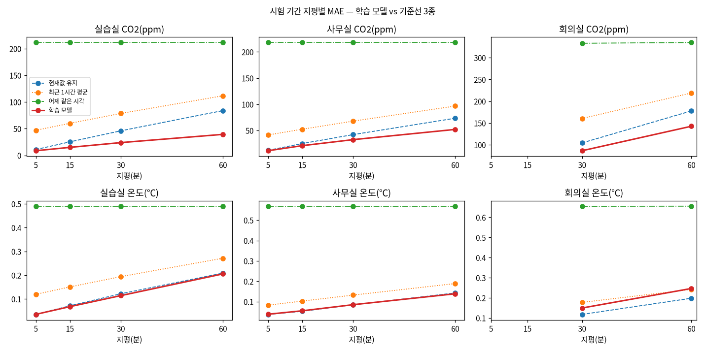

# 과제 3 산출물 ① 모델 비교표

> **측정 조건**
> - 데이터: 실데이터(과제 2 공간 5분 시계열). 분할 `v1-provisional`
>   - 학습 2025-09-04 ~ 2026-03-31
>   - 검증 2026-04-02 ~ 05-09
>   - **시험 2026-05-27 ~ 07-22**(KST, 57일)
> - 평가 시점: 과제 2와 같은 파일(sha256 `2f878c11d09ab68d…`, 289,277행), 같은 정답(관측 칸만)
> - 선택: 검증 기간만 사용. 고정 파일 sha256 `900fb554ba710ae8…`(2026-10-21 17:23). 시험 평가는 고정 뒤 한 번 했다.
> - 학습: Jetson Orin Nano Super GPU(25W, 클럭 고정 안 함), PyTorch 2.14.1+cu130, TF32 끔·결정적 설정. 씨앗 3개 평균 ± 표준편차
> - 숫자 원본: [결과 표 ①](tables/01-comparison.md), 다시 만들기 `forecast report`

## 최종 모델

**GRU(2층, 은닉 64) · 과거 2시간 · 입력 전부(센서·시간·공간·일정) · 60분 12칸 한 번에 출력 · 변화량 예측**, 파라미터 68,440개.

검증 기간 MAE로 한 단계씩 골랐다.

| 단계 | 비교 | 고른 것 | 근거(검증 정규화 MAE) |
|---|---|---|---|
| 과거 길이 | 30분 · 2시간 · 4시간 | 2시간 | 4시간과 같음(0.0480 ± 0.0003) → 더 단순한 쪽 |
| 입력 정보 | 센서 → +시간 → +공간 → +일정 | 전부 | 0.0523 → 0.0501 → 0.0488 → **0.0480**. 묶음마다 꾸준히 좋아짐 |
| 출력 방식 | 한 번에 · 한 칸씩 반복 | 한 번에 | 0.0480 vs 0.0486. 반복은 학습 시간 8배(698초) |
| 목표 | 변화량 · 값 | 변화량 | 0.0480 vs 0.0510 |
| 모델 × 과거 길이(9조합) | GRU·LSTM·TCN × 1·2·4시간 | GRU 2시간 | GRU가 모든 길이에서 최소. 4시간과 차이가 변동 안 → 2시간 |

## 세 모델 × 과거 길이 비교 — 왜 GRU인가

입력 전부·한 번에 출력·변화량 목표로 고정하고, **모델(GRU·LSTM·TCN)과 과거 길이(1·2·4시간)만** 바꿨다. 9조합 × 씨앗 3개다.
- **선택 근거는 검증 기간뿐이다.** 왼쪽 열이다.
- 시험 열은 선택을 고정한 뒤 보고용으로 낸 값이다(`forecast b1-test`). 시험 결과로 바꾼 결정은 없다.

| 모델 | 과거 | **검증 정규화 MAE**(선택 기준) | 시험 CO₂ 60분: 실습실 | 사무실 | 회의실 | 실습실 사용 시간대 | 시험 온도 60분(실습실) | 파라미터 | 학습 시간 |
|---|---|---|---|---|---|---|---|---|---|
| GRU | 1시간 | 0.0486 ± 0.0002 | 38.9 | 53.1 | 141.7 | 90.4 | 0.21 | 68,440 | 92초 |
| **GRU** | **2시간** | **0.0480 ± 0.0003** ◀ | **39.3** | **52.0** | **142.6** | **92.0** | **0.21** | **68,440** | **83초** |
| GRU | 4시간 | 0.0480 ± 0.0003 | 38.7 | 51.9 | 143.2 | 90.3 | 0.19 | 68,440 | 111초 |
| LSTM | 1시간 | 0.0503 ± 0.0003 | 40.6 | 54.3 | 146.9 | 92.7 | 0.23 | 82,200 | 79초 |
| LSTM | 2시간 | 0.0504 ± 0.0005 | 40.9 | 54.6 | 144.9 | 94.0 | 0.25 | 82,200 | 91초 |
| LSTM | 4시간 | 0.0504 ± 0.0004 | 41.3 | 54.9 | 145.1 | 96.0 | 0.24 | 82,200 | 142초 |
| TCN | 1시간 | 0.0497 ± 0.0001 | 41.1 | 55.5 | 142.3 | 94.7 | 0.23 | 69,208 | 157초 |
| TCN | 2시간 | 0.0495 ± 0.0004 | 42.6 | 53.1 | 139.2 | 98.7 | 0.23 | 93,912 | 229초 |
| TCN | 4시간 | 0.0495 ± 0.0004 | 42.4 | 53.6 | **138.5** | 99.6 | 0.22 | 118,616 | 332초 |
| (현재값 유지) | — | — | 83.9 | 73.4 | 177.8 | 212.1 | 0.21 | — | — |

(시험 MAE 단위: CO₂ ppm, 온도 ℃. 씨앗 3개 평균. 정규화 MAE = 공간 × 항목 × 지평 5·15·30·60분 평균)

**기준선 3종 + 학습 모델 3종 — 지평별 시험 MAE**(CO₂ ppm, 학습 모델은 과거 2시간, 과제 2와 같은 평가 시점)

| 방법 | 실습실 5분 | 15분 | 30분 | 60분 | 사무실 5분 | 15분 | 30분 | 60분 | 회의실 30분 | 60분 |
|---|---|---|---|---|---|---|---|---|---|---|
| 어제 같은 시각 | 211.5 | 211.5 | 211.5 | 211.5 | 217.9 | 217.9 | 217.9 | 217.9 | 333.0 | 334.8 |
| 최근 1시간 평균 | 47.0 | 60.0 | 78.5 | 111.6 | 41.5 | 52.3 | 67.9 | 96.6 | 160.4 | 218.9 |
| 현재값 유지 | 10.9 | 25.2 | 46.0 | 83.9 | 12.2 | 25.0 | 42.1 | 73.4 | 104.3 | 177.8 |
| LSTM | 8.8 | 15.6 | 25.0 | 40.9 | 11.5 | 21.5 | 33.6 | 54.6 | 89.3 | 144.9 |
| TCN | 8.7 | 15.5 | 25.3 | 42.6 | 11.4 | 21.2 | 32.8 | 53.1 | **82.8** | **139.2** |
| **GRU(최종)** | **8.6** | **14.9** | **23.9** | **39.3** | **11.4** | **21.0** | **32.5** | **52.0** | **86.4** | **142.6** |

(회의실 5·15분은 10분 주기 센서라 평가 불가. 온도와 사용 시간대 표는 아래 "시험 기간 MAE"와 [결과 표](tables/01-comparison.md). 9조합 전체는 `var/forecast/b1_test.parquet`)

**GRU를 고른 이유**
1. **검증에서 모든 과거 길이에서 가장 낮다.** GRU 0.0480 < TCN 0.0495 < LSTM 0.0504다. 차이(3~5%)는 씨앗 변동(±0.0003~0.0005)의 10배쯤이라 우연이 아니다.
2. **과거 길이는 2시간이면 충분하다.**
   - 1시간 → 2시간은 조금 나아진다(0.0486 → 0.0480). 2시간 → 4시간은 같다.
   - 규칙("최소와 1표준편차 안이면 더 단순한 쪽")에 따라 2시간을 골랐다. 짧은 과거는 입력이 적고, 서비스 시작 직후나 결측 뒤에도 빨리 예측할 수 있다.
3. **비용도 가장 싸다.** 파라미터가 가장 적고(68,440), 학습이 가장 빠르다(83초). TCN 4시간은 층을 더 쌓아야 해서 파라미터 1.7배, 학습 4배다.
4. **시험에서도 순서가 같다.** 실습실·사무실 CO₂와 온도에서 GRU가 모든 과거 길이에서 가장 낮다.
   - 예외는 회의실이다. TCN이 3% 낮다(138.5 vs 142.6ppm).
   - 회의실은 세 모델 모두 현재값 유지보다 20%만 낫고, 오차의 대부분이 "예측할 수 없는 회의 시작"이다([②](02-space-error-analysis.md)). 이 차이로 모델을 바꿀 근거는 약하다.
5. **LSTM이 가장 나쁜 이유**: 게이트가 하나 더 있어 파라미터가 20% 많다. 학습 표본(약 13만)에 비해 커서 이득을 보지 못했다.
6. 참고로 과거 **하루(24시간)**도 시험했다(GRU, 씨앗 1). 검증 0.0469로 2% 나았지만 학습 6배·메모리 3.6GB라 2026-10-21에 후보에서 뺐다([research R15](../../../specs/003-forecast-60min/research.md)).

## 확인 기준 판정

| 기준 | 공간 | 현재값 유지 | 학습 모델 | 개선율 | 판정 |
|---|---|---|---|---|---|
| CO₂ 60분 MAE 30% 이상 감소 | **실습실** | 83.9ppm | **39.3 ± 0.4ppm** | **53.1%** | ✅ |
| | 사무실 | 73.4ppm | 52.0 ± 0.3ppm | 29.1% | ❌ (0.9%p 미달) |
| | 회의실 | 177.8ppm | 142.6 ± 0.8ppm | 19.8% | ❌ |
| 온도 60분이 현재값 유지보다 좋음 | 실습실 | 0.21℃ | 0.21 ± 0.02℃ | 1.7% | ✅ (차이가 씨앗 변동 안) |
| | 사무실 | 0.14℃ | 0.14 ± 0.00℃ | 2.8% | ✅ |
| | 회의실 | 0.20℃ | 0.25 ± 0.01℃ | −24.5% | ❌ |
| 시험 기간을 학습·선택에 쓰지 않음 | — | — | 누수 자동 시험 통과, 선택 고정 뒤 시험 평가 | — | ✅ |

**판정 요약**
- README 확인 기준의 대표 대상인 **실습실 CO₂는 53% 개선으로 통과**했다.
- 온도는 실습실·사무실에서 "현재값 유지보다 좋다"를 형식상 만족했다. 그러나 차이가 씨앗 변동 안이라 **실질적인 개선은 없다**고 판단한다.
- 회의실은 CO₂·온도 모두 기준에 못 미친다. 원인은 [② 공간별 오차 분석](02-space-error-analysis.md)에 있다.

## 시험 기간 MAE (지평별)

**전체 시간** (CO₂ ppm, 온도 ℃)

| 공간 | 항목 | 5분 | 15분 | 30분 | 60분 |
|---|---|---|---|---|---|
| 실습실 | CO₂ 현재값 유지 → 모델 | 10.9 → **8.6** | 25.2 → **14.9** | 46.0 → **23.9** | 83.9 → **39.3** |
| 실습실 | 온도 | 0.04 → 0.04 | 0.07 → 0.07 | 0.12 → 0.11 | 0.21 → 0.21 |
| 사무실 | CO₂ | 12.2 → **11.4** | 25.0 → **21.0** | 42.1 → **32.5** | 73.4 → **52.0** |
| 사무실 | 온도 | 0.04 → 0.04 | 0.05 → 0.05 | 0.08 → 0.08 | 0.14 → 0.14 |
| 회의실 | CO₂ | 평가 불가 | 평가 불가 | 104.3 → **86.4** | 177.8 → **142.6** |
| 회의실 | 온도 | 평가 불가 | 평가 불가 | 0.12 → 0.15 | 0.20 → 0.25 |

**사용 시간대**(평일·공휴일 제외·08~19시) — 예측이 실제로 필요한 시간

| 공간 | 항목 | 5분 | 15분 | 30분 | 60분 |
|---|---|---|---|---|---|
| 실습실 | CO₂ | 22.1 → **15.7** | 60.4 → **32.1** | 115.4 → **54.2** | 212.1 → **92.0**(56.6%) |
| 사무실 | CO₂ | 22.2 → 20.9 | 52.7 → 47.7 | 91.0 → 79.3 | 158.0 → 131.1(17.0%) |
| 회의실 | CO₂ | — | — | 293.7 → 250.1 | 511.8 → 431.6(15.7%) |

- 다른 기준선 두 개(최근 1시간 평균, 어제 같은 시각)는 모든 칸에서 현재값 유지보다 나빴다(과제 2와 같음). 전체 표는 [결과 표 ①](tables/01-comparison.md)에 있다.
- 회의실 5·15분이 평가 불가인 이유는 과제 2와 같다. 10분 주기 센서라 정답 관측 칸이 58개뿐이다.

## 해석

**왜 실습실에서 크게 이겼나**
- 실습실 오차는 대부분 "일정이 바뀌는 순간"에서 나온다.
  - 현재값 유지는 수업 시작 직후 CO₂가 오르는 것을 60분 내내 놓친다. 수업 시작 단계 MAE가 177.8ppm이다.
  - 모델은 시각·요일·일과표를 알고 있어 상승을 미리 그린다(41.1ppm, 77% 감소).
- 지평이 길수록 개선율이 커진다(5분 21% → 60분 53%). 짧은 지평에서는 "그대로"가 이미 정답에 가깝고, 긴 지평일수록 일정 정보의 몫이 커지기 때문이다.

**값 예측 대신 변화량 예측을 고른 이유**(생각해 볼 점 Q2)
- 변화량 목표에서는 출력 0이 곧 현재값 유지다. 모델은 가장 강한 기준선에서 출발해 "얼마나 바뀔지"만 배운다.
- 값 목표는 매 칸 수준 자체를 다시 맞혀야 한다. 그래서 검증 오차가 6% 컸고(0.0510 vs 0.0480), 학습도 2배 오래 걸렸다(에폭 34 vs 14).
- 다만 실습실 CO₂ 60분 하나만 보면 값 목표가 조금 나았다(30.5 vs 31.1ppm). 수준이 크게 바뀌는 구간에서는 값 목표가 유리할 수 있다. 전체 평균에서는 변화량이 확실히 낫다.

**한 번에 출력 vs 반복 예측**
- 한 번에 출력이 약간 낫고(0.0480 vs 0.0486) 학습은 8배 빠르다.
- 반복 예측은 자기 예측을 다시 입력에 넣는다. 그래서 오차가 쌓이고 학습 비용도 12배다. 과거 하루 입력으로는 실행 하나에 몇 시간이 걸려 비교에서 뺐다(research R15).

**온도가 개선되지 않은 이유**
- 학습 기간(가을·겨울, 난방)과 시험 기간(초여름, 냉방)의 계절이 다르다. 과제 2 진단에서 예고한 분포 이동이다. 모델이 배운 "오후에 데워지는 모양"이 냉방기와 맞지 않는다.
- 온도는 60분 안에 0.2℃ 정도만 바뀐다. 개선 여지 자체가 작고, 그 크기가 센서 분해능(0.1℃) 수준이다.
- 2학기 시험(`v2-final`, InfluxDB 미적재분 적재 뒤)을 하면 계절 이동이 줄어 판정이 달라질 수 있다.

**일정 정보의 기여** → [③ 일정 정보 포함/제외](03-schedule-value.md)
