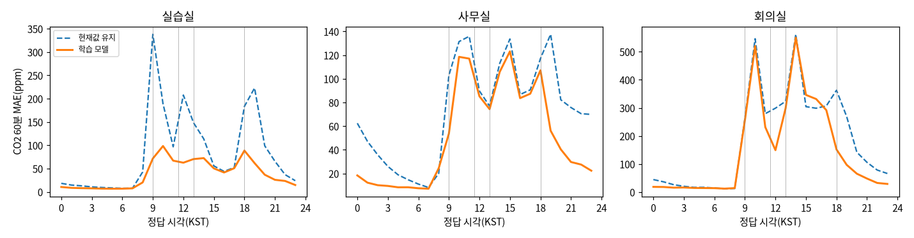
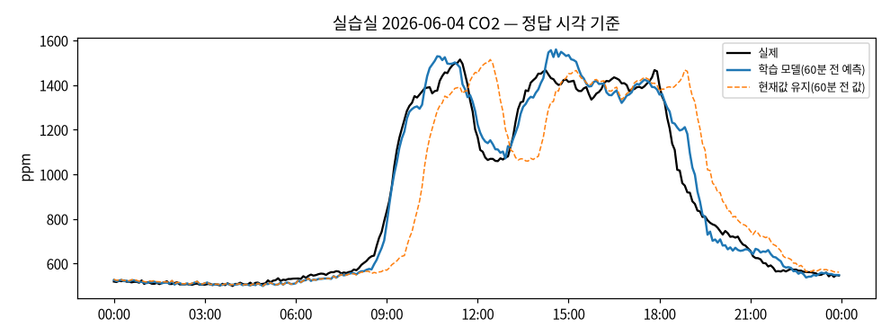
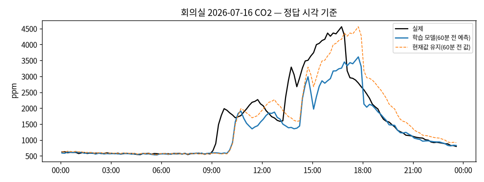

# 과제 3 결과 표 ② 공간별 오차 분석 (자동 생성)

> **측정 조건**
> - 실데이터(과제 2 공간 5분 시계열). 분할 `v1-provisional`: 학습 2025-09-04 ~ 2026-03-31, 검증 2026-04-02 ~ 2026-05-09, **시험 2026-05-27 ~ 2026-07-22**(KST)
> - 평가 시점 파일 sha256 `2f878c11d09ab68d…`(과제 2와 같은 행·같은 정답), 선택 고정 sha256 `900fb554ba710ae8…`(2026-10-21T08:23:22+00:00)
> - 장치 Orin(Jetson Orin Nano Super, 전력 모드 25W), torch 2.14.1+cu130, TF32 끔·결정적 설정, 씨앗 3개(평균 ± 표준편차)
> - 다시 만들기: `forecast report`(표·그래프), 해석은 사람이 쓴다

## 일과 단계별 CO₂ 60분 MAE(정답 시각 기준, 씨앗 평균 예측)

| 공간 | 단계 | n | 학습 모델 | 현재값 유지 | 개선율(%) |
|---|---|---|---|---|---|
| 실습실 | 야간(19~08시) | 5,988 | 20.3 | 54.4 | 62.7 |
| 실습실 | 출근·수업 시작(08~09:30) | 684 | 41.1 | 177.8 | 76.9 |
| 실습실 | 오전 일과(09:30~11:30) | 912 | 129.8 | 319.6 | 59.4 |
| 실습실 | 점심(11:30~13:00) | 684 | 87.0 | 242.9 | 64.2 |
| 실습실 | 오후 일과(13:00~18:00) | 2,295 | 72.7 | 110.0 | 33.9 |
| 실습실 | 퇴실(18~19시) | 468 | 118.6 | 257.4 | 53.9 |
| 실습실 | 주말·공휴일 | 5,184 | 14.0 | 15.9 | 11.8 |
| 회의실 | 야간(19~08시) | 2,864 | 37.8 | 89.1 | 57.6 |
| 회의실 | 출근·수업 시작(08~09:30) | 315 | 47.3 | 48.1 | 1.8 |
| 회의실 | 오전 일과(09:30~11:30) | 387 | 661.1 | 683.1 | 3.2 |
| 회의실 | 점심(11:30~13:00) | 287 | 239.2 | 437.6 | 45.3 |
| 회의실 | 오후 일과(13:00~18:00) | 965 | 542.6 | 536.3 | -1.2 |
| 회의실 | 퇴실(18~19시) | 201 | 212.6 | 526.1 | 59.6 |
| 회의실 | 주말·공휴일 | 2,436 | 16.6 | 17.1 | 3.3 |
| 사무실 | 야간(19~08시) | 5,988 | 24.1 | 68.5 | 64.7 |
| 사무실 | 출근·수업 시작(08~09:30) | 684 | 41.1 | 59.4 | 30.8 |
| 사무실 | 오전 일과(09:30~11:30) | 912 | 151.3 | 188.1 | 19.5 |
| 사무실 | 점심(11:30~13:00) | 684 | 138.1 | 150.6 | 8.4 |
| 사무실 | 오후 일과(13:00~18:00) | 2,295 | 135.1 | 143.1 | 5.6 |
| 사무실 | 퇴실(18~19시) | 468 | 148.5 | 163.0 | 8.9 |
| 사무실 | 주말·공휴일 | 5,184 | 10.1 | 11.6 | 12.4 |

## 오차 상위 20개(CO₂ 60분)

| 공간 | 정답 시각(KST) | 단계 | 정답 | 예측 | 현재값 | 오차 |
|---|---|---|---|---|---|---|
| 회의실 | 06-30(Tue) 14:25 | 오후 일과(13:00~18:00) | 4104.0 | 1137.0 | 1184.0 | -2967.0 |
| 회의실 | 06-30(Tue) 14:35 | 오후 일과(13:00~18:00) | 4345.0 | 1817.0 | 1738.0 | -2528.0 |
| 회의실 | 06-30(Tue) 14:15 | 오후 일과(13:00~18:00) | 3689.0 | 1170.0 | 1245.0 | -2519.0 |
| 회의실 | 07-20(Mon) 14:55 | 오후 일과(13:00~18:00) | 3092.0 | 721.0 | 684.0 | -2371.0 |
| 회의실 | 07-10(Fri) 10:25 | 오전 일과(09:30~11:30) | 3013.0 | 682.0 | 667.0 | -2331.0 |
| 회의실 | 07-09(Thu) 10:15 | 오전 일과(09:30~11:30) | 2977.0 | 687.0 | 673.0 | -2290.0 |
| 회의실 | 07-21(Tue) 10:05 | 오전 일과(09:30~11:30) | 2843.0 | 565.0 | 543.0 | -2278.0 |
| 회의실 | 07-08(Wed) 13:55 | 오후 일과(13:00~18:00) | 3245.0 | 1038.0 | 1013.0 | -2207.0 |
| 회의실 | 06-17(Wed) 10:25 | 오전 일과(09:30~11:30) | 2831.0 | 653.0 | 634.0 | -2178.0 |
| 회의실 | 07-02(Thu) 14:25 | 오후 일과(13:00~18:00) | 2935.0 | 764.0 | 745.0 | -2171.0 |
| 회의실 | 07-20(Mon) 14:45 | 오후 일과(13:00~18:00) | 2842.0 | 674.0 | 642.0 | -2168.0 |
| 회의실 | 07-14(Tue) 13:55 | 오후 일과(13:00~18:00) | 3082.0 | 927.0 | 921.0 | -2155.0 |
| 회의실 | 07-22(Wed) 10:15 | 오전 일과(09:30~11:30) | 2817.0 | 662.0 | 644.0 | -2155.0 |
| 회의실 | 06-30(Tue) 14:05 | 오후 일과(13:00~18:00) | 3372.0 | 1226.0 | 1322.0 | -2146.0 |
| 회의실 | 06-17(Wed) 12:25 | 점심(11:30~13:00) | 777.0 | 2913.0 | 3649.0 | 2136.0 |
| 회의실 | 07-21(Tue) 10:15 | 오전 일과(09:30~11:30) | 3024.0 | 924.0 | 826.0 | -2100.0 |
| 회의실 | 07-09(Thu) 10:05 | 오전 일과(09:30~11:30) | 2724.0 | 636.0 | 623.0 | -2088.0 |
| 회의실 | 07-03(Fri) 14:25 | 오후 일과(13:00~18:00) | 2741.0 | 681.0 | 676.0 | -2060.0 |
| 회의실 | 07-20(Mon) 14:35 | 오후 일과(13:00~18:00) | 2699.0 | 669.0 | 633.0 | -2030.0 |
| 회의실 | 07-14(Tue) 13:45 | 오후 일과(13:00~18:00) | 2890.0 | 865.0 | 945.0 | -2025.0 |

## 창문 개방 추정 구간(사용 시간대 10분 안 −200ppm, 일과 경계 제외) — 시험 기간 65회

| space_id | n | model | persistence |
|---|---|---|---|
| lab | 21 | 361.4 | 694.8 |
| meeting | 187 | 586.0 | 637.4 |
| office | 42 | 337.2 | 376.9 |

## 시험 기간 밀집 사건(B3) 구간 — 7건, 사건 시작 뒤 2시간

| space_id | n | model | persistence |
|---|---|---|---|
| lab | 25 | 171.0 | 236.3 |
| meeting | 60 | 852.1 | 836.7 |

