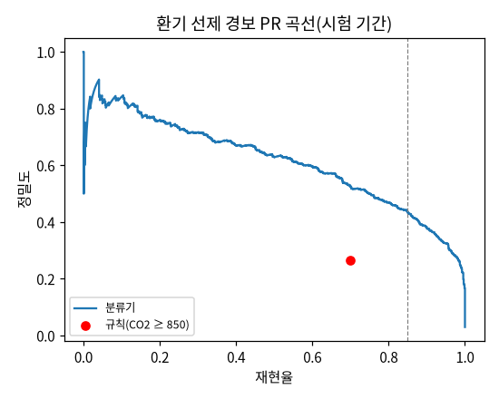

# 과제 5 결과 표 ① 성적표·혼동 행렬 (자동 생성)

> **측정 조건**
> - 실데이터(과제 2 공간 5분 시계열). 분할 `v1-provisional`: 학습 2025-09-04 ~ 2026-03-31, 검증 2026-04-02 ~ 2026-05-09, 시험 2026-05-27 ~ 2026-07-22(KST). 관찰 기준은 실시간 수집 기간(2026-10-20~)의 직접 관찰
> - 선택 고정 sha256 `da67e470f29cfafd…`(2026-10-21T10:51:32+00:00), 씨앗 3개 평균 확률
> - 관찰 진행: 전체 3.7/20시간

## 확인 기준 판정

| 기준 | 결과 | 판정 |
|---|---|---|
| 환기 경보 재현율 ≥ 85% | 67.1% | ❌ |
| 환기 경보 macro-F1 > 단순 규칙(850ppm) | 0.798 vs 0.675 | ✅ |
| 사용 여부(직접 관찰 기준) 정확도·F1·비어있음→사용중 오류율, 규칙보다 좋음 | 관찰 목표 미달(전체 3.7/20시간) | ⏸ 판단 보류 |

## 환기 선제 경보(시험 기간, 양성 = 지금 < 1,000ppm이고 30분 안에 ≥ 1,000)

선택: hgb(class_weight=balanced, learning_rate=0.1, max_depth=None), 임계값 0.6371(검증 재현율 ≥ 85% 중 정밀도 최대)

| 방법 | 칸 수 | 정확도 | 재현율 | 정밀도 | F1 | macro-F1 | 비어있음→사용중(헛 사용중) | 항상 음성 정확도 |
|---|---|---|---|---|---|---|---|---|
| 분류기 | 30,135 | 0.974 | 0.671 | 0.558 | 0.609 | 0.798 | 0.016 | 0.970 |
| 규칙 CO₂ ≥ 850 | 30,135 | 0.933 | 0.698 | 0.266 | 0.385 | 0.675 | 0.059 | 0.970 |

하루당 헛경보(공간 합): 분류기 8.4, 규칙 30.5. 선행 시간 중앙 15.0분

분류기 혼동 행렬:

| 정답 \ 예측 | 양성(1) | 음성(0) |
|---|---|---|
| 양성(1) | 605 | 297 |
| 음성(0) | 480 | 28,753 |

과제 3 예측 기반 판정: {"status": "done", "threshold_ppm": 929.0400483703613, "delta_ppm": 70.95995162963868, "val": {"tp": 490, "fp": 480, "fn": 86, "tn": 21754, "n": 22810, "accuracy": 0.9751863217886891, "recall": 0.8506944444444444, "precision": 0.5051546391752577, "f1": 0.6338939197930142, "macro_f1": 0.8105259407015168, "false_occupied_rate": 0.02158855806422596, "always_negative_accuracy": 0.9747479175800088}, "r

## 사용 여부

선택: hgb(class_weight=balanced, learning_rate=0.05, max_depth=3), 임계값 0.5908(검증 macro-F1 최대)

### 직접 관찰 기준(확인 기준)

| 방법 | 칸 수 |
|---|---|
| 분류기 | 0 |
| 규칙 15분 +30ppm | 0 |
| 누수 실험(일정·시각 입력) | 0 |

분류기 혼동 행렬:

(자료 없음)

### 일정 기반 정답(시험 기간, 실습실·사무실)

| 방법 | 칸 수 | 정확도 | 재현율 | 정밀도 | F1 | macro-F1 | 비어있음→사용중(헛 사용중) | 항상 음성 정확도 |
|---|---|---|---|---|---|---|---|---|
| 분류기 | 32,832 | 0.884 | 0.921 | 0.665 | 0.773 | 0.847 | 0.126 | 0.786 |
| 규칙 15분 +30ppm | 32,832 | 0.856 | 0.436 | 0.800 | 0.564 | 0.739 | 0.030 | 0.786 |
| 누수 실험(일정·시각 입력) | 32,832 | 1.000 | 1.000 | 1.000 | 1.000 | 1.000 | 0.000 | 0.786 |

분류기 혼동 행렬:

| 정답 \ 예측 | 양성(1) | 음성(0) |
|---|---|---|
| 양성(1) | 6,468 | 552 |
| 음성(0) | 3,256 | 22,556 |
