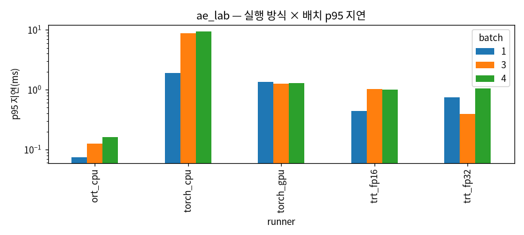
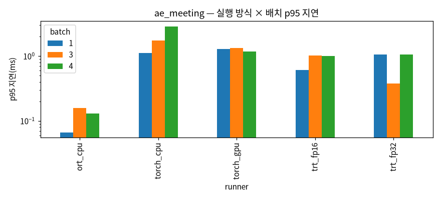
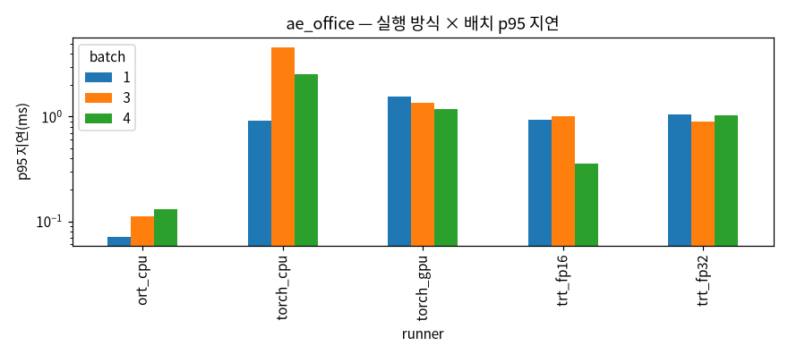
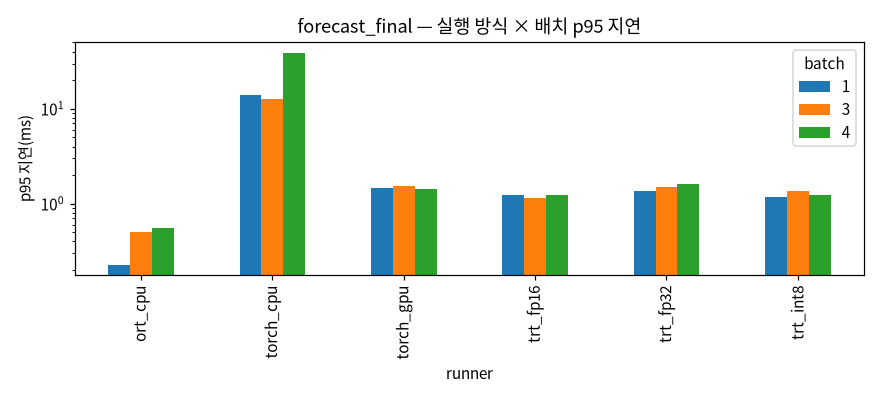
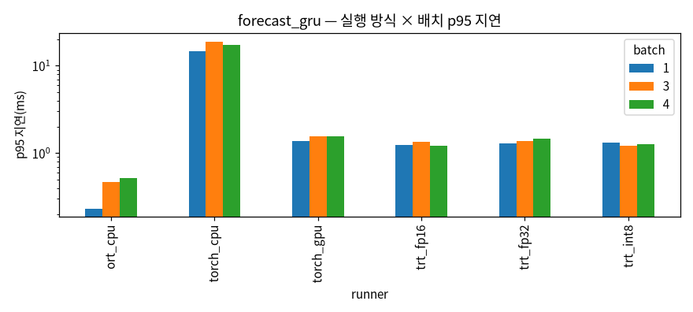
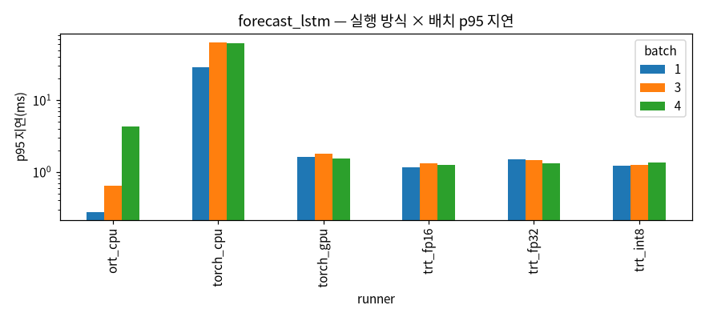
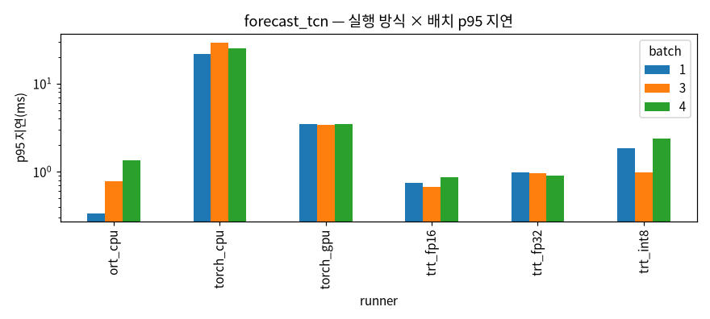

# 과제 7 결과 표 ① 실행 방식 × 모델 (자동 생성)

> **측정 조건**
> - 보드: Jetson Orin Nano Super, L4T # R39 (release), 전력 모드 25W, **클럭 고정 안 함**(sudo 없음 — jetson_clocks 불가)
> - torch 2.14.1+cu130(CUDA 13.0), TensorRT 10.16.2.10, ONNX Runtime 1.31.0
> - 지연: 호스트 입력 → 실행 → 동기화 → 호스트 출력, 워밍업 50·반복 1,000·3구간. 조합마다 새 프로세스. 전력은 tegrastats 1초 간격(대기 10초 대비 증가분)
> - 결과 차이: 과제 3 시험 표본 전체, 기준 PyTorch CPU FP32, 원 단위 복원은 엔진 밖 FP32
> - 다시 만들기: `edgeopt report`

## 동작 확인(probe)

| model | onnx | ort_cpu | ort_cuda | ort_trt | trt_fp16 |
|---|---|---|---|---|---|
| linear | ✅ | ✅ 3.0e-08 | ❌ Fail: [ONNXRuntimeError] : 1 : FAIL : Non-zero status code returned while running Gemm | ❌ RuntimeError: TensorrtExecutionProvider 없음(사용 가능: ['CUDAExecutionProvider', 'CPUExecutionProvi | ✅ 1.1e-04 |
| conv1d | ✅ | ✅ 6.0e-08 | ❌ Fail: [ONNXRuntimeError] : 1 : FAIL : Non-zero status code returned while running Tran | ❌ RuntimeError: TensorrtExecutionProvider 없음(사용 가능: ['CUDAExecutionProvider', 'CPUExecutionProvi | ✅ 7.1e-05 |
| gru | ✅ | ✅ 4.5e-08 | ❌ Fail: [ONNXRuntimeError] : 1 : FAIL : Non-zero status code returned while running Tran | ❌ RuntimeError: TensorrtExecutionProvider 없음(사용 가능: ['CUDAExecutionProvider', 'CPUExecutionProvi | ✅ 1.6e-04 |

## 결과 차이 판정(확인 기준 1)

| 모델 | 방식 | CO₂ 최대 차이(ppm) | 온도 최대 차이(℃) | 경보·분류 바뀐 비율 | 판정 |
|---|---|---|---|---|---|
| forecast_final | torch_gpu | 0.0041 | 2e-05 | — | ✅ |
| forecast_final | ort_cpu | 0.0005 | 0.0 | — | ✅ |
| forecast_final | ort_cuda | — | — | — | failed |
| forecast_final | trt_fp16 | 2.433 | 0.0142 | — | ❌ |
| forecast_final | ort_trt | — | — | — | failed |
| forecast_final | trt_int8 | 2.3682 | 0.01302 | — | ❌ |
| forecast_final | trt_fp32 | 0.0004 | 0.0 | — | ✅ |
| forecast_gru | torch_gpu | 0.0041 | 2e-05 | — | ✅ |
| forecast_gru | ort_cpu | 0.0005 | 0.0 | — | ✅ |
| forecast_gru | ort_cuda | — | — | — | failed |
| forecast_gru | trt_fp16 | 2.9601 | 0.01302 | — | ❌ |
| forecast_gru | ort_trt | — | — | — | failed |
| forecast_gru | trt_int8 | 2.8021 | 0.01655 | — | ❌ |
| forecast_gru | trt_fp32 | 0.0006 | 0.0 | — | ✅ |
| forecast_lstm | torch_gpu | 0.0081 | 3e-05 | — | ✅ |
| forecast_lstm | ort_cpu | 0.0003 | 0.0 | — | ✅ |
| forecast_lstm | ort_cuda | — | — | — | failed |
| forecast_lstm | trt_fp16 | 2.2143 | 0.00582 | — | ❌ |
| forecast_lstm | ort_trt | — | — | — | failed |
| forecast_lstm | trt_int8 | 2.2143 | 0.00582 | — | ❌ |
| forecast_lstm | trt_fp32 | 0.0004 | 0.0 | — | ✅ |
| forecast_tcn | torch_gpu | 0.0004 | 0.0 | — | ✅ |
| forecast_tcn | ort_cpu | 0.0004 | 0.0 | — | ✅ |
| forecast_tcn | ort_cuda | — | — | — | failed |
| forecast_tcn | trt_fp16 | 0.3769 | 0.0017 | — | ✅ |
| forecast_tcn | ort_trt | — | — | — | failed |
| forecast_tcn | trt_int8 | 0.3768 | 0.0017 | — | ✅ |
| forecast_tcn | trt_fp32 | 0.0004 | 0.0 | — | ✅ |
| ae_lab | torch_gpu | — | — | 0.0000% | ✅ |
| ae_lab | ort_cpu | — | — | 0.0000% | ✅ |
| ae_lab | ort_cuda | — | — | — | failed |
| ae_lab | trt_fp16 | — | — | 0.0061% | ✅ |
| ae_lab | ort_trt | — | — | — | failed |
| ae_lab | trt_int8 | — | — | — | failed |
| ae_lab | trt_fp32 | — | — | 0.0000% | ✅ |
| ae_office | torch_gpu | — | — | 0.0000% | ✅ |
| ae_office | ort_cpu | — | — | 0.0000% | ✅ |
| ae_office | ort_cuda | — | — | — | failed |
| ae_office | trt_fp16 | — | — | 0.0122% | ✅ |
| ae_office | ort_trt | — | — | — | failed |
| ae_office | trt_int8 | — | — | — | failed |
| ae_office | trt_fp32 | — | — | 0.0000% | ✅ |
| ae_meeting | torch_gpu | — | — | 0.0000% | ✅ |
| ae_meeting | ort_cpu | — | — | 0.0000% | ✅ |
| ae_meeting | ort_cuda | — | — | — | failed |
| ae_meeting | trt_fp16 | — | — | 0.0061% | ✅ |
| ae_meeting | ort_trt | — | — | — | failed |
| ae_meeting | trt_int8 | — | — | — | failed |
| ae_meeting | trt_fp32 | — | — | 0.0000% | ✅ |

## 지연·메모리·전력

| model | runner | batch | threads | status | mean_ms | p95_ms | p99_ms | rss_mb | gpu_mb | delta_mw | mj_per_call | gr3d | contention | error |
|---|---|---|---|---|---|---|---|---|---|---|---|---|---|---|
| ae_lab | ort_cpu | 1 | 1.0 | ok | 0.055 | 0.057 | 0.074 | 556.7 | nan | nan | nan | nan | False |  |
| ae_lab | ort_cpu | 1 | 6.0 | ok | 0.07 | 0.075 | 0.183 | 544.5 | nan | nan | nan | nan | False |  |
| ae_lab | ort_cpu | 3 | 1.0 | ok | 0.081 | 0.085 | 0.109 | 557.2 | nan | nan | nan | nan | False |  |
| ae_lab | ort_cpu | 3 | 6.0 | ok | 0.117 | 0.127 | 0.184 | 557.3 | nan | nan | nan | nan | False |  |
| ae_lab | ort_cpu | 4 | 1.0 | ok | 0.091 | 0.094 | 0.11 | 557.7 | nan | nan | nan | nan | False |  |
| ae_lab | ort_cpu | 4 | 6.0 | ok | 0.142 | 0.16 | 0.233 | 557.2 | nan | nan | nan | nan | False |  |
| ae_meeting | ort_cpu | 1 | 1.0 | ok | 0.051 | 0.052 | 0.072 | 552.4 | nan | nan | nan | nan | False |  |
| ae_meeting | ort_cpu | 1 | 6.0 | ok | 0.061 | 0.067 | 0.118 | 552.7 | nan | nan | nan | nan | False |  |
| ae_meeting | ort_cpu | 3 | 1.0 | ok | 0.069 | 0.078 | 0.141 | 553.5 | nan | nan | nan | nan | False |  |
| ae_meeting | ort_cpu | 3 | 6.0 | ok | 0.097 | 0.159 | 0.278 | 553.3 | nan | nan | nan | nan | False |  |
| ae_meeting | ort_cpu | 4 | 1.0 | ok | 0.079 | 0.089 | 0.121 | 552.0 | nan | nan | nan | nan | False |  |
| ae_meeting | ort_cpu | 4 | 6.0 | ok | 0.118 | 0.129 | 0.16 | 554.3 | nan | nan | nan | nan | False |  |
| ae_office | ort_cpu | 1 | 1.0 | ok | 0.062 | 0.063 | 0.087 | 556.6 | nan | nan | nan | nan | False |  |
| ae_office | ort_cpu | 1 | 6.0 | ok | 0.069 | 0.071 | 0.085 | 558.4 | nan | nan | nan | nan | False |  |
| ae_office | ort_cpu | 3 | 1.0 | ok | 0.072 | 0.074 | 0.098 | 557.4 | nan | nan | nan | nan | False |  |
| ae_office | ort_cpu | 3 | 6.0 | ok | 0.102 | 0.111 | 0.143 | 557.4 | nan | 344.0 | 0.038 | 0.0 | False |  |
| ae_office | ort_cpu | 4 | 1.0 | ok | 0.079 | 0.082 | 0.106 | 556.5 | nan | nan | nan | nan | False |  |
| ae_office | ort_cpu | 4 | 6.0 | ok | 0.122 | 0.131 | 0.157 | 557.5 | nan | nan | nan | nan | False |  |
| forecast_final | ort_cpu | 1 | 1.0 | ok | 0.217 | 0.232 | 0.242 | 560.7 | nan | nan | nan | nan | False |  |
| forecast_final | ort_cpu | 1 | 6.0 | ok | 0.212 | 0.228 | 0.248 | 561.9 | nan | nan | nan | nan | False |  |
| forecast_final | ort_cpu | 3 | 1.0 | ok | 0.458 | 0.48 | 0.494 | 561.1 | nan | nan | nan | nan | False |  |
| forecast_final | ort_cpu | 3 | 6.0 | ok | 0.458 | 0.5 | 0.77 | 561.1 | nan | nan | nan | nan | False |  |
| forecast_final | ort_cpu | 4 | 1.0 | ok | 0.568 | 0.59 | 0.602 | 560.7 | nan | 646.0 | 0.387 | 0.0 | False |  |
| forecast_final | ort_cpu | 4 | 6.0 | ok | 0.512 | 0.551 | 0.676 | 561.8 | nan | nan | nan | nan | False |  |
| forecast_gru | ort_cpu | 1 | 1.0 | ok | 0.22 | 0.239 | 0.294 | 559.7 | nan | nan | nan | nan | False |  |
| forecast_gru | ort_cpu | 1 | 6.0 | ok | 0.213 | 0.233 | 0.295 | 559.0 | nan | 861.0 | 0.196 | 0.0 | False |  |
| forecast_gru | ort_cpu | 3 | 1.0 | ok | 0.456 | 0.475 | 0.484 | 558.3 | nan | 493.0 | 0.238 | 0.0 | False |  |
| forecast_gru | ort_cpu | 3 | 6.0 | ok | 0.413 | 0.465 | 0.506 | 559.4 | nan | 2352.0 | 1.027 | 0.0 | False |  |
| forecast_gru | ort_cpu | 4 | 1.0 | ok | 0.573 | 0.645 | 0.663 | 558.6 | nan | -99.0 | -0.06 | 0.0 | False |  |
| forecast_gru | ort_cpu | 4 | 6.0 | ok | 0.496 | 0.516 | 0.602 | 558.5 | nan | 3134.0 | 1.643 | 0.0 | False |  |
| forecast_lstm | ort_cpu | 1 | 1.0 | ok | 0.27 | 0.292 | 0.326 | 558.5 | nan | nan | nan | nan | False |  |
| forecast_lstm | ort_cpu | 1 | 6.0 | ok | 0.303 | 0.277 | 3.751 | 559.1 | nan | 1244.0 | 0.399 | 0.0 | False |  |
| forecast_lstm | ort_cpu | 3 | 1.0 | ok | 0.559 | 0.602 | 0.631 | 559.2 | nan | 681.0 | 0.405 | 0.0 | False |  |
| forecast_lstm | ort_cpu | 3 | 6.0 | ok | 0.406 | 0.643 | 4.383 | 560.4 | nan | 1927.0 | 0.855 | 0.0 | False |  |
| forecast_lstm | ort_cpu | 4 | 1.0 | ok | 0.691 | 0.726 | 0.761 | 559.8 | nan | -87.0 | -0.064 | 0.0 | False |  |
| forecast_lstm | ort_cpu | 4 | 6.0 | ok | 0.689 | 4.347 | 4.857 | 559.3 | nan | 178.0 | 0.131 | 0.0 | False |  |
| forecast_tcn | ort_cpu | 1 | 1.0 | ok | 0.238 | 0.259 | 0.277 | 559.4 | nan | nan | nan | nan | False |  |
| forecast_tcn | ort_cpu | 1 | 6.0 | ok | 0.303 | 0.338 | 4.299 | 560.9 | nan | 1174.0 | 0.377 | 0.0 | False |  |
| forecast_tcn | ort_cpu | 3 | 1.0 | ok | 0.558 | 0.602 | 0.629 | 558.4 | nan | 579.0 | 0.342 | 0.0 | False |  |
| forecast_tcn | ort_cpu | 3 | 6.0 | ok | 0.625 | 0.783 | 4.541 | 559.9 | nan | nan | nan | nan | False |  |
| forecast_tcn | ort_cpu | 4 | 1.0 | ok | 0.715 | 0.754 | 0.801 | 559.6 | nan | 607.0 | 0.46 | 0.0 | False |  |
| forecast_tcn | ort_cpu | 4 | 6.0 | ok | 0.835 | 1.338 | 4.71 | 557.5 | nan | 2325.0 | 2.027 | 0.0 | False |  |
| ae_lab | ort_cuda | 1 | nan | failed | nan | nan | nan | nan | nan | nan | nan | nan | None | Fail: [ONNXRuntimeError] : 1 : FAIL : Non-zero status code returned while runnin |
| ae_lab | ort_cuda | 3 | nan | failed | nan | nan | nan | nan | nan | nan | nan | nan | None | Fail: [ONNXRuntimeError] : 1 : FAIL : Non-zero status code returned while runnin |
| ae_lab | ort_cuda | 4 | nan | failed | nan | nan | nan | nan | nan | nan | nan | nan | None | Fail: [ONNXRuntimeError] : 1 : FAIL : Non-zero status code returned while runnin |
| ae_meeting | ort_cuda | 1 | nan | failed | nan | nan | nan | nan | nan | nan | nan | nan | None | Fail: [ONNXRuntimeError] : 1 : FAIL : Non-zero status code returned while runnin |
| ae_meeting | ort_cuda | 3 | nan | failed | nan | nan | nan | nan | nan | nan | nan | nan | None | Fail: [ONNXRuntimeError] : 1 : FAIL : Non-zero status code returned while runnin |
| ae_meeting | ort_cuda | 4 | nan | failed | nan | nan | nan | nan | nan | nan | nan | nan | None | Fail: [ONNXRuntimeError] : 1 : FAIL : Non-zero status code returned while runnin |
| ae_office | ort_cuda | 1 | nan | failed | nan | nan | nan | nan | nan | nan | nan | nan | None | Fail: [ONNXRuntimeError] : 1 : FAIL : Non-zero status code returned while runnin |
| ae_office | ort_cuda | 3 | nan | failed | nan | nan | nan | nan | nan | nan | nan | nan | None | Fail: [ONNXRuntimeError] : 1 : FAIL : Non-zero status code returned while runnin |
| ae_office | ort_cuda | 4 | nan | failed | nan | nan | nan | nan | nan | nan | nan | nan | None | Fail: [ONNXRuntimeError] : 1 : FAIL : Non-zero status code returned while runnin |
| forecast_final | ort_cuda | 1 | nan | failed | nan | nan | nan | nan | nan | nan | nan | nan | None | Fail: [ONNXRuntimeError] : 1 : FAIL : Non-zero status code returned while runnin |
| forecast_final | ort_cuda | 3 | nan | failed | nan | nan | nan | nan | nan | nan | nan | nan | None | Fail: [ONNXRuntimeError] : 1 : FAIL : Non-zero status code returned while runnin |
| forecast_final | ort_cuda | 4 | nan | failed | nan | nan | nan | nan | nan | nan | nan | nan | None | Fail: [ONNXRuntimeError] : 1 : FAIL : Non-zero status code returned while runnin |
| forecast_gru | ort_cuda | 1 | nan | failed | nan | nan | nan | nan | nan | nan | nan | nan | None | Fail: [ONNXRuntimeError] : 1 : FAIL : Non-zero status code returned while runnin |
| forecast_gru | ort_cuda | 3 | nan | failed | nan | nan | nan | nan | nan | nan | nan | nan | None | Fail: [ONNXRuntimeError] : 1 : FAIL : Non-zero status code returned while runnin |
| forecast_gru | ort_cuda | 4 | nan | failed | nan | nan | nan | nan | nan | nan | nan | nan | None | Fail: [ONNXRuntimeError] : 1 : FAIL : Non-zero status code returned while runnin |
| forecast_lstm | ort_cuda | 1 | nan | failed | nan | nan | nan | nan | nan | nan | nan | nan | None | Fail: [ONNXRuntimeError] : 1 : FAIL : Non-zero status code returned while runnin |
| forecast_lstm | ort_cuda | 3 | nan | failed | nan | nan | nan | nan | nan | nan | nan | nan | None | Fail: [ONNXRuntimeError] : 1 : FAIL : Non-zero status code returned while runnin |
| forecast_lstm | ort_cuda | 4 | nan | failed | nan | nan | nan | nan | nan | nan | nan | nan | None | Fail: [ONNXRuntimeError] : 1 : FAIL : Non-zero status code returned while runnin |
| forecast_tcn | ort_cuda | 1 | nan | failed | nan | nan | nan | nan | nan | nan | nan | nan | None | Fail: [ONNXRuntimeError] : 1 : FAIL : Non-zero status code returned while runnin |
| forecast_tcn | ort_cuda | 3 | nan | failed | nan | nan | nan | nan | nan | nan | nan | nan | None | Fail: [ONNXRuntimeError] : 1 : FAIL : Non-zero status code returned while runnin |
| forecast_tcn | ort_cuda | 4 | nan | failed | nan | nan | nan | nan | nan | nan | nan | nan | None | Fail: [ONNXRuntimeError] : 1 : FAIL : Non-zero status code returned while runnin |
| ae_lab | torch_cpu | 1 | 1.0 | ok | 0.436 | 0.463 | 0.478 | 521.8 | nan | nan | nan | nan | False |  |
| ae_lab | torch_cpu | 1 | 6.0 | ok | 1.502 | 1.898 | 4.193 | 522.9 | nan | 1490.0 | 2.368 | 0.0 | False |  |
| ae_lab | torch_cpu | 3 | 1.0 | ok | 5.081 | 7.151 | 9.001 | 521.4 | nan | 1560.0 | 8.331 | 0.0 | False |  |
| ae_lab | torch_cpu | 3 | 6.0 | ok | 6.555 | 8.803 | 11.455 | 523.3 | nan | 1445.0 | 9.931 | 0.0 | False |  |
| ae_lab | torch_cpu | 4 | 1.0 | ok | 5.105 | 6.92 | 9.158 | 523.8 | nan | 1647.0 | 8.881 | 0.0 | False |  |
| ae_lab | torch_cpu | 4 | 6.0 | ok | 6.717 | 9.459 | 11.928 | 523.3 | nan | 1207.0 | 8.505 | 0.0 | False |  |
| ae_meeting | torch_cpu | 1 | 1.0 | ok | 0.417 | 0.438 | 0.463 | 523.9 | nan | nan | nan | nan | False |  |
| ae_meeting | torch_cpu | 1 | 6.0 | ok | 0.933 | 1.117 | 1.749 | 533.3 | nan | 816.0 | 0.811 | 8.0 | False |  |
| ae_meeting | torch_cpu | 3 | 1.0 | ok | 1.502 | 2.213 | 4.625 | 529.4 | nan | 1714.0 | 2.712 | 0.0 | False |  |
| ae_meeting | torch_cpu | 3 | 6.0 | ok | 1.515 | 1.74 | 5.01 | 527.3 | nan | 1510.0 | 2.415 | 0.0 | False |  |
| ae_meeting | torch_cpu | 4 | 1.0 | ok | 1.629 | 2.993 | 5.027 | 530.0 | nan | 1715.0 | 2.998 | 0.0 | False |  |
| ae_meeting | torch_cpu | 4 | 6.0 | ok | 1.633 | 2.876 | 5.239 | 530.5 | nan | 1931.0 | 3.386 | 0.0 | False |  |
| ae_office | torch_cpu | 1 | 1.0 | ok | 0.431 | 0.464 | 0.51 | 533.3 | nan | nan | nan | nan | False |  |
| ae_office | torch_cpu | 1 | 6.0 | ok | 0.52 | 0.915 | 1.027 | 532.3 | nan | 1339.0 | 0.748 | 0.0 | False |  |
| ae_office | torch_cpu | 3 | 1.0 | ok | 3.176 | 8.551 | 10.051 | 534.1 | nan | 2218.0 | 8.091 | 1.0 | False |  |
| ae_office | torch_cpu | 3 | 6.0 | ok | 1.754 | 4.627 | 5.784 | 534.3 | nan | 1838.0 | 3.456 | 0.0 | False |  |
| ae_office | torch_cpu | 4 | 1.0 | ok | 3.329 | 8.319 | 15.522 | 534.3 | nan | 2172.0 | 7.479 | 0.0 | False |  |
| ae_office | torch_cpu | 4 | 6.0 | ok | 1.611 | 2.537 | 5.133 | 534.3 | nan | 1937.0 | 3.326 | 0.0 | False |  |
| forecast_final | torch_cpu | 1 | 1.0 | ok | 11.952 | 20.74 | 50.4 | 541.8 | nan | 2434.0 | 30.646 | 0.0 | False |  |
| forecast_final | torch_cpu | 1 | 6.0 | ok | 10.621 | 13.844 | 28.851 | 539.9 | nan | 2297.0 | 25.644 | 0.0 | False |  |
| forecast_final | torch_cpu | 3 | 1.0 | ok | 10.712 | 16.085 | 20.551 | 540.8 | nan | 2587.0 | 29.054 | 0.0 | False |  |
| forecast_final | torch_cpu | 3 | 6.0 | ok | 10.583 | 12.616 | 30.395 | 541.8 | nan | 2283.0 | 25.439 | 0.0 | False |  |
| forecast_final | torch_cpu | 4 | 1.0 | ok | 10.878 | 15.325 | 22.977 | 540.4 | nan | 2383.0 | 27.207 | 0.0 | False |  |
| forecast_final | torch_cpu | 4 | 6.0 | ok | 13.458 | 39.114 | 60.309 | 541.1 | nan | 2666.0 | 37.379 | 0.0 | False |  |
| forecast_gru | torch_cpu | 1 | 1.0 | ok | 13.685 | 39.496 | 81.962 | 537.7 | nan | 2520.0 | 36.041 | 0.0 | False |  |
| forecast_gru | torch_cpu | 1 | 6.0 | ok | 10.827 | 14.794 | 34.453 | 536.7 | nan | 2575.0 | 29.35 | 0.0 | False |  |
| forecast_gru | torch_cpu | 3 | 1.0 | ok | 12.61 | 29.481 | 39.023 | 537.4 | nan | 2321.0 | 30.544 | 0.0 | False |  |
| forecast_gru | torch_cpu | 3 | 6.0 | ok | 11.324 | 18.998 | 33.455 | 538.1 | nan | 2566.0 | 30.433 | 0.0 | False |  |
| forecast_gru | torch_cpu | 4 | 1.0 | ok | 12.607 | 27.472 | 34.335 | 536.1 | nan | 2484.0 | 32.692 | 0.0 | False |  |
| forecast_gru | torch_cpu | 4 | 6.0 | ok | 11.167 | 17.46 | 35.451 | 535.4 | nan | 2647.0 | 31.073 | 0.0 | False |  |
| forecast_lstm | torch_cpu | 1 | 1.0 | ok | 3.4 | 4.0 | 4.495 | 536.6 | nan | 1219.0 | 4.369 | 0.0 | False |  |
| forecast_lstm | torch_cpu | 1 | 6.0 | ok | 24.5 | 28.666 | 34.743 | 534.9 | nan | 1814.0 | 46.732 | 0.0 | False |  |
| forecast_lstm | torch_cpu | 3 | 1.0 | ok | 5.009 | 5.248 | 5.464 | 537.1 | nan | 538.0 | 2.839 | 0.0 | False |  |
| forecast_lstm | torch_cpu | 3 | 6.0 | ok | 46.672 | 64.658 | 93.388 | 535.6 | nan | 1788.0 | 87.407 | 0.0 | False |  |
| forecast_lstm | torch_cpu | 4 | 1.0 | ok | 6.248 | 6.53 | 7.061 | 536.0 | nan | 830.0 | 5.462 | 0.0 | False |  |
| forecast_lstm | torch_cpu | 4 | 6.0 | ok | 47.066 | 63.088 | 95.859 | 535.4 | nan | 1467.0 | 72.587 | 0.0 | False |  |
| forecast_tcn | torch_cpu | 1 | 1.0 | ok | 3.32 | 3.742 | 4.471 | 537.0 | nan | 1178.0 | 4.12 | 0.0 | False |  |
| forecast_tcn | torch_cpu | 1 | 6.0 | ok | 10.693 | 21.673 | 26.488 | 534.9 | nan | 1828.0 | 20.536 | 0.0 | False |  |
| forecast_tcn | torch_cpu | 3 | 1.0 | ok | 6.823 | 8.438 | 10.235 | 537.2 | nan | 1610.0 | 11.627 | 0.0 | False |  |
| forecast_tcn | torch_cpu | 3 | 6.0 | ok | 17.163 | 29.435 | 37.334 | 537.3 | nan | 1750.0 | 31.481 | 0.0 | False |  |
| forecast_tcn | torch_cpu | 4 | 1.0 | ok | 6.787 | 9.106 | 10.537 | 537.1 | nan | 1416.0 | 10.121 | 0.0 | False |  |
| forecast_tcn | torch_cpu | 4 | 6.0 | ok | 17.057 | 25.312 | 33.377 | 537.8 | nan | 1553.0 | 27.848 | 0.0 | False |  |
| ae_lab | torch_gpu | 1 | nan | ok | 1.172 | 1.339 | 1.419 | 941.9 | 0.0 | 694.0 | 1.036 | 0.0 | False |  |
| ae_lab | torch_gpu | 3 | nan | ok | 1.164 | 1.254 | 1.412 | 936.8 | 0.0 | 1979.0 | 2.919 | 0.0 | False |  |
| ae_lab | torch_gpu | 4 | nan | ok | 1.159 | 1.286 | 1.367 | 936.6 | 0.0 | 674.0 | 0.999 | 5.0 | False |  |
| ae_meeting | torch_gpu | 1 | nan | ok | 1.174 | 1.292 | 1.355 | 978.4 | 0.0 | 892.0 | 1.497 | 9.0 | False |  |
| ae_meeting | torch_gpu | 3 | nan | ok | 1.234 | 1.334 | 1.469 | 987.6 | 0.0 | 920.0 | 1.424 | 0.0 | False |  |
| ae_meeting | torch_gpu | 4 | nan | ok | 1.122 | 1.179 | 1.241 | 988.0 | 0.0 | 744.0 | 1.075 | 4.0 | False |  |
| ae_office | torch_gpu | 1 | nan | ok | 1.521 | 1.541 | 1.597 | 954.4 | 0.0 | 185.0 | 0.339 | 97.0 | False |  |
| ae_office | torch_gpu | 3 | nan | ok | 1.232 | 1.354 | 1.885 | 955.5 | 0.0 | 838.0 | 1.302 | 0.0 | False |  |
| ae_office | torch_gpu | 4 | nan | ok | 1.109 | 1.179 | 1.275 | 954.5 | 0.0 | 461.0 | 0.658 | 5.0 | False |  |
| forecast_final | torch_gpu | 1 | nan | ok | 1.316 | 1.475 | 1.546 | 942.6 | 32.5 | 805.0 | 1.186 | 0.0 | False |  |
| forecast_final | torch_gpu | 3 | nan | ok | 1.379 | 1.543 | 1.62 | 938.5 | 32.7 | 909.0 | 1.39 | 8.0 | False |  |
| forecast_final | torch_gpu | 4 | nan | ok | 1.371 | 1.444 | 1.597 | 938.9 | 32.9 | 1307.0 | 1.981 | 5.0 | False |  |
| forecast_gru | torch_gpu | 1 | nan | ok | 1.335 | 1.374 | 1.395 | 940.5 | 32.5 | 866.0 | 1.283 | 5.0 | False |  |
| forecast_gru | torch_gpu | 3 | nan | ok | 1.381 | 1.558 | 1.599 | 934.2 | 32.7 | 904.0 | 1.376 | 10.0 | False |  |
| forecast_gru | torch_gpu | 4 | nan | ok | 1.398 | 1.561 | 1.594 | 934.3 | 32.9 | 1185.0 | 1.825 | 0.0 | False |  |
| forecast_lstm | torch_gpu | 1 | nan | ok | 1.44 | 1.62 | 1.674 | 929.4 | 32.7 | 929.0 | 1.512 | 12.0 | False |  |
| forecast_lstm | torch_gpu | 3 | nan | ok | 1.566 | 1.795 | 2.455 | 925.1 | 32.9 | 1052.0 | 1.827 | 11.0 | False |  |
| forecast_lstm | torch_gpu | 4 | nan | ok | 1.48 | 1.522 | 1.547 | 925.0 | 33.1 | 641.0 | 1.056 | 12.0 | False |  |
| forecast_tcn | torch_gpu | 1 | nan | ok | 3.362 | 3.473 | 3.66 | 1038.8 | 32.4 | 834.0 | 3.289 | 8.0 | False |  |
| forecast_tcn | torch_gpu | 3 | nan | ok | 3.327 | 3.379 | 3.518 | 1022.8 | 32.4 | 562.0 | 2.137 | 8.0 | False |  |
| forecast_tcn | torch_gpu | 4 | nan | ok | 3.304 | 3.478 | 3.563 | 1022.4 | 32.5 | 1069.0 | 4.001 | 8.0 | False |  |
| ae_lab | trt_fp16 | 1 | nan | ok | 0.356 | 0.437 | 0.574 | 895.2 | 0.0 | nan | nan | nan | False |  |
| ae_lab | trt_fp16 | 3 | nan | ok | 0.46 | 1.018 | 1.056 | 894.8 | 0.0 | nan | nan | nan | False |  |
| ae_lab | trt_fp16 | 4 | nan | ok | 0.544 | 0.989 | 1.494 | 893.9 | 0.0 | 693.0 | 0.447 | 13.0 | False |  |
| ae_meeting | trt_fp16 | 1 | nan | ok | 0.391 | 0.606 | 1.355 | 922.2 | 0.0 | nan | nan | nan | False |  |
| ae_meeting | trt_fp16 | 3 | nan | ok | 0.743 | 1.022 | 1.074 | 924.7 | 0.0 | nan | nan | nan | False |  |
| ae_meeting | trt_fp16 | 4 | nan | ok | 0.732 | 1.004 | 1.341 | 923.2 | 0.0 | 19.0 | 0.016 | 0.0 | False |  |
| ae_office | trt_fp16 | 1 | nan | ok | 0.528 | 0.925 | 1.289 | 893.1 | 0.0 | 1249.0 | 0.773 | 13.0 | False |  |
| ae_office | trt_fp16 | 3 | nan | ok | 0.543 | 1.008 | 1.347 | 893.0 | 0.0 | 698.0 | 0.445 | 13.0 | False |  |
| ae_office | trt_fp16 | 4 | nan | ok | 0.338 | 0.358 | 0.384 | 891.4 | 0.0 | 984.0 | 0.378 | 0.0 | False |  |
| forecast_final | trt_fp16 | 1 | nan | ok | 1.14 | 1.223 | 1.345 | 999.9 | 0.0 | 984.0 | 1.281 | 47.0 | False |  |
| forecast_final | trt_fp16 | 3 | nan | ok | 1.098 | 1.134 | 1.164 | 995.2 | 0.0 | 421.0 | 0.517 | 24.0 | False |  |
| forecast_final | trt_fp16 | 4 | nan | ok | 1.126 | 1.248 | 1.356 | 1000.7 | 0.0 | 700.0 | 0.879 | 24.0 | False |  |
| forecast_gru | trt_fp16 | 1 | nan | ok | 1.166 | 1.247 | 1.374 | 997.7 | 0.0 | 1079.0 | 1.418 | 0.0 | False |  |
| forecast_gru | trt_fp16 | 3 | nan | ok | 1.191 | 1.356 | 1.467 | 978.6 | 0.0 | 865.0 | 1.198 | 24.0 | False |  |
| forecast_gru | trt_fp16 | 4 | nan | ok | 1.156 | 1.219 | 1.389 | 986.9 | 0.0 | 830.0 | 1.108 | 24.0 | False |  |
| forecast_lstm | trt_fp16 | 1 | nan | ok | 1.133 | 1.173 | 1.423 | 987.2 | 0.0 | 1110.0 | 1.497 | 24.0 | False |  |
| forecast_lstm | trt_fp16 | 3 | nan | ok | 1.16 | 1.302 | 1.436 | 988.4 | 0.0 | 635.0 | 0.852 | 0.0 | False |  |
| forecast_lstm | trt_fp16 | 4 | nan | ok | 1.167 | 1.264 | 1.405 | 988.0 | 0.0 | 857.0 | 1.142 | 24.0 | False |  |
| forecast_tcn | trt_fp16 | 1 | nan | ok | 0.628 | 0.755 | 0.838 | 886.8 | 0.0 | nan | nan | nan | False |  |
| forecast_tcn | trt_fp16 | 3 | nan | ok | 0.635 | 0.672 | 0.697 | 886.6 | 0.0 | -42.0 | -0.03 | 0.0 | False |  |
| forecast_tcn | trt_fp16 | 4 | nan | ok | 0.673 | 0.863 | 0.979 | 886.1 | 0.0 | 644.0 | 0.494 | 29.0 | False |  |
| ae_lab | trt_fp32 | 1 | nan | ok | 0.423 | 0.745 | 0.858 | 1021.6 | 0.0 | nan | nan | nan | False |  |
| ae_lab | trt_fp32 | 3 | nan | ok | 0.358 | 0.389 | 0.747 | 1019.8 | 0.0 | nan | nan | nan | False |  |
| ae_lab | trt_fp32 | 4 | nan | ok | 0.565 | 1.054 | 1.087 | 1021.5 | 0.0 | nan | nan | nan | False |  |
| ae_meeting | trt_fp32 | 1 | nan | ok | 0.672 | 1.049 | 1.075 | 1019.0 | 0.0 | 758.0 | 0.619 | 37.0 | False |  |
| ae_meeting | trt_fp32 | 3 | nan | ok | 0.351 | 0.375 | 0.392 | 1022.7 | 0.0 | nan | nan | nan | False |  |
| ae_meeting | trt_fp32 | 4 | nan | ok | 0.663 | 1.056 | 1.086 | 1021.8 | 0.0 | 712.0 | 0.577 | 27.0 | False |  |
| ae_office | trt_fp32 | 1 | nan | ok | 0.649 | 1.05 | 1.087 | 1021.6 | 0.0 | 658.0 | 0.526 | 36.0 | False |  |
| ae_office | trt_fp32 | 3 | nan | ok | 0.571 | 0.902 | 1.094 | 1020.7 | 0.0 | nan | nan | nan | False |  |
| ae_office | trt_fp32 | 4 | nan | ok | 0.572 | 1.037 | 1.089 | 1021.7 | 0.0 | nan | nan | nan | False |  |
| forecast_final | trt_fp32 | 1 | nan | ok | 1.27 | 1.376 | 1.868 | 929.7 | 0.0 | 975.0 | 1.4 | 26.0 | False |  |
| forecast_final | trt_fp32 | 3 | nan | ok | 1.27 | 1.496 | 1.848 | 931.2 | 0.0 | 904.0 | 1.294 | 0.0 | True |  |
| forecast_final | trt_fp32 | 4 | nan | ok | 1.309 | 1.599 | 1.978 | 931.0 | 0.0 | 1081.0 | 1.6 | 27.0 | False |  |
| forecast_gru | trt_fp32 | 1 | nan | ok | 1.237 | 1.293 | 1.355 | 1021.3 | 0.0 | 1042.0 | 1.465 | 26.0 | False |  |
| forecast_gru | trt_fp32 | 3 | nan | ok | 1.256 | 1.37 | 1.569 | 1022.0 | 0.0 | 1096.0 | 1.587 | 52.0 | False |  |
| forecast_gru | trt_fp32 | 4 | nan | ok | 1.306 | 1.456 | 1.558 | 1022.0 | 0.0 | 998.0 | 1.486 | 0.0 | True |  |
| forecast_lstm | trt_fp32 | 1 | nan | ok | 1.343 | 1.504 | 2.701 | 1021.6 | 0.0 | 1847.0 | 2.831 | 26.0 | False |  |
| forecast_lstm | trt_fp32 | 3 | nan | ok | 1.284 | 1.449 | 1.569 | 1019.5 | 0.0 | 1170.0 | 1.717 | 27.0 | False |  |
| forecast_lstm | trt_fp32 | 4 | nan | ok | 1.267 | 1.318 | 1.396 | 1019.4 | 0.0 | 1155.0 | 1.661 | 26.0 | False |  |
| forecast_tcn | trt_fp32 | 1 | nan | ok | 0.696 | 0.979 | 1.175 | 1029.3 | 0.0 | 925.0 | 0.8 | 29.0 | False |  |
| forecast_tcn | trt_fp32 | 3 | nan | ok | 0.679 | 0.959 | 1.09 | 1029.2 | 0.0 | 955.0 | 0.81 | 28.0 | False |  |
| forecast_tcn | trt_fp32 | 4 | nan | ok | 0.677 | 0.912 | 1.03 | 1028.9 | 0.0 | nan | nan | nan | False |  |
| ae_lab | trt_int8 | 1 | nan | failed | nan | nan | nan | nan | nan | nan | nan | nan | None | RuntimeError: trt_int8 엔진 없음 — `edgeopt build` 먼저(또는 probe 실패) |
| ae_lab | trt_int8 | 3 | nan | failed | nan | nan | nan | nan | nan | nan | nan | nan | None | RuntimeError: trt_int8 엔진 없음 — `edgeopt build` 먼저(또는 probe 실패) |
| ae_lab | trt_int8 | 4 | nan | failed | nan | nan | nan | nan | nan | nan | nan | nan | None | RuntimeError: trt_int8 엔진 없음 — `edgeopt build` 먼저(또는 probe 실패) |
| ae_meeting | trt_int8 | 1 | nan | failed | nan | nan | nan | nan | nan | nan | nan | nan | None | RuntimeError: trt_int8 엔진 없음 — `edgeopt build` 먼저(또는 probe 실패) |
| ae_meeting | trt_int8 | 3 | nan | failed | nan | nan | nan | nan | nan | nan | nan | nan | None | RuntimeError: trt_int8 엔진 없음 — `edgeopt build` 먼저(또는 probe 실패) |
| ae_meeting | trt_int8 | 4 | nan | failed | nan | nan | nan | nan | nan | nan | nan | nan | None | RuntimeError: trt_int8 엔진 없음 — `edgeopt build` 먼저(또는 probe 실패) |
| ae_office | trt_int8 | 1 | nan | failed | nan | nan | nan | nan | nan | nan | nan | nan | None | RuntimeError: trt_int8 엔진 없음 — `edgeopt build` 먼저(또는 probe 실패) |
| ae_office | trt_int8 | 3 | nan | failed | nan | nan | nan | nan | nan | nan | nan | nan | None | RuntimeError: trt_int8 엔진 없음 — `edgeopt build` 먼저(또는 probe 실패) |
| ae_office | trt_int8 | 4 | nan | failed | nan | nan | nan | nan | nan | nan | nan | nan | None | RuntimeError: trt_int8 엔진 없음 — `edgeopt build` 먼저(또는 probe 실패) |
| forecast_final | trt_int8 | 1 | nan | ok | 1.147 | 1.186 | 1.239 | 938.2 | 0.0 | 954.0 | 1.239 | 48.0 | False |  |
| forecast_final | trt_int8 | 3 | nan | ok | 1.172 | 1.351 | 1.695 | 938.8 | 0.0 | 662.0 | 0.884 | 0.0 | False |  |
| forecast_final | trt_int8 | 4 | nan | ok | 1.147 | 1.235 | 1.319 | 937.9 | 0.0 | 755.0 | 0.979 | 0.0 | False |  |
| forecast_gru | trt_int8 | 1 | nan | ok | 1.177 | 1.328 | 1.464 | 1029.0 | 0.0 | 924.0 | 1.27 | 24.0 | False |  |
| forecast_gru | trt_int8 | 3 | nan | ok | 1.163 | 1.215 | 1.266 | 1029.6 | 0.0 | 837.0 | 1.122 | 24.0 | False |  |
| forecast_gru | trt_int8 | 4 | nan | ok | 1.17 | 1.255 | 1.475 | 1029.6 | 0.0 | 943.0 | 1.295 | 49.0 | False |  |
| forecast_lstm | trt_int8 | 1 | nan | ok | 1.148 | 1.233 | 1.401 | 1027.4 | 0.0 | 1046.0 | 1.402 | 47.0 | False |  |
| forecast_lstm | trt_int8 | 3 | nan | ok | 1.161 | 1.248 | 1.382 | 1030.6 | 0.0 | 708.0 | 0.958 | 0.0 | False |  |
| forecast_lstm | trt_int8 | 4 | nan | ok | 1.176 | 1.365 | 1.518 | 1028.4 | 0.0 | 964.0 | 1.321 | 24.0 | False |  |
| forecast_tcn | trt_int8 | 1 | nan | ok | 0.782 | 1.832 | 2.349 | 939.1 | 0.0 | 111.0 | 0.104 | 0.0 | False |  |
| forecast_tcn | trt_int8 | 3 | nan | ok | 0.677 | 0.985 | 1.322 | 936.3 | 0.0 | 985.0 | 0.791 | 27.0 | False |  |
| forecast_tcn | trt_int8 | 4 | nan | ok | 1.069 | 2.365 | 2.414 | 937.4 | 0.0 | 871.0 | 1.066 | 16.0 | False |  |

