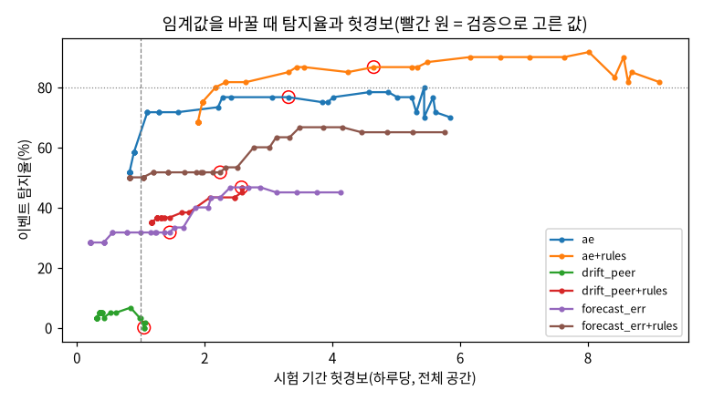

# 결과 보고서 — 교육장 센서 시계열 추론 (team2)

> 교육장 센서(CO₂·온도·습도)로 "지금 무슨 일이 일어나고 있고, 곧 어떻게 될까"에 답하는 기능을 만들어 팀 Jetson에서 상시 운영한다.
> 과제 1~8의 산출물을 묶었다. 표마다 측정 조건을 붙였다. 자세한 근거는 각 절의 링크(산출물·점검 문서)를 따라간다.
> 작성 2026-10-22. 트랙: **심화(B)** — 과제별 심화 항목 전부 수행(2개는 외부 자료 부족으로 보류, 6절·5절 참고).

**공통 측정 조건**(표마다 다른 것만 따로 적는다)

| 항목 | 값 |
|---|---|
| 데이터 | **실데이터**(합성 아님). 과거분 InfluxDB 2025-08-08 ~ 2026-10-20(1,395만 행), 실시간 수집 2026-10-20 16:33 ~ |
| 분할 `v1-provisional` | 학습 2025-09-04 ~ 2026-03-31 · 검증 2026-04-02 ~ 05-09 · **시험 2026-05-27 ~ 07-22**(KST) |
| 평가 시점 | 과제 2가 만든 파일 하나를 과제 3~6이 공유(sha256 `2f878c11d09ab68d…`). 입력·정답은 관측 칸만 |
| 공간 | 실습실(CO₂ 센서 4·온습도 8대, 1~2분), 사무실(1~2대, 1분), 회의실(1대, **10분**) |
| 보드 | Jetson Orin Nano Super, RAM 7.3GB(CPU·GPU 공유, 스왑 없음), **전력 모드 25W, 클럭 고정 안 함**(sudo 없음). 다른 계정 서비스와 공유 |
| 선택 원칙 | 모델·임계값·크기는 **검증 기간으로만** 고르고 sha256으로 고정한 뒤 시험을 한 번 연다 |

---

## 1. 데이터 수집 체계(과제 1)

| 확인 기준 | 결과 | 판정 | 측정 조건 |
|---|---|---|---|
| 브로커 재시작 뒤 1분 안 재수집 | 6.0초(자동 시험), 실제 끊김 15초 | ✅ | 보드 내 시험 브로커 / 운영 MQTT |
| 재부팅 뒤 자동 시작 | 부팅 +28초 첫 저장(로그인 전) | ✅ | 2026-10-20 실제 재부팅 |
| 24시간 커버율 ≥ 95% | 핵심 항목 최저 **98.6%**(회의실), 실습실 99.9%, 사무실 99.8% | ✅ | 2026-10-20 16:40 ~ 10-21 16:40 |

- **형식 변경에 설정만으로 대응**: 원천 규칙(경로 표현식)과 공간 매핑이 `config/collector.yaml`에 있다. 가정 2개(필드 이름 변경, 새 원천)를 코드 0줄로 처리했다.
- **의외의 발견**
  - 게이트웨이 한 대의 시계가 **4분 55초 빠르다**. 센서 시각을 그대로 썼다면 LoRa 행의 40%가 틀렸다. → 네트워크 서버 시각을 기준으로 저장한다.
  - ChirpStack이 같은 업링크를 **두 번** 발행한다(3.4%). → 장치·프레임 번호로 중복을 거른다(심화).
- **심화**: 1년 저장량 8.2GB → 90일 원본 + 5분 집계로 4.0GB. 재전송 탐지·처리.
- 과거 데이터 1,395만 행을 같은 형식으로 적재했다. 실시간 빈틈(장애 시험 중 수집기 정지)은 InfluxDB에서 빈틈 안쪽만 채웠다(699행).

→ [수집 현황 보고](../deliverables/task1/01-coverage-report.md) · [형식 변경 대응](../deliverables/task1/02-format-change.md) · [점검](../tasks/task1-data-collection.md)

## 2. 데이터 이해와 기준선(과제 2)

**정제·분할 결정**

| 결정 | 내용 | 근거 |
|---|---|---|
| 정제 | 원본은 지우지 않는다. **축 A 센서 오류**(오류 코드·불가능 값 → 제외)와 **축 B 실제 사건**(화재·누수·밀집 → 값 유지, 사건 후보 표시)을 나눈다 | "범위 밖이면 제거"는 회의실 4,000~7,000ppm 같은 실제 사건을 지웠다 |
| 결측 | 자기 보고 주기 × 2를 넘으면 결측. 학습·평가 입력은 관측 칸만, 빈 칸은 앞으로만 채움 | 장치마다 주기가 1·2·10분으로 다르다 |
| 분석 간격 | **5분** | 1분은 칸의 48%가 빈다. 15분은 수업 시작 반응(5분)을 뭉갠다 |
| 분할 | 시간 순, 버전 고정 | 5분 자기상관 0.999. 무작위로 섞으면 이웃 칸 베끼기가 된다 |

- 실습실 CO₂는 09:00 수업 시작 뒤 **5분 안에** 반응한다(측정일의 99%). 수업일 09~18시 평균은 1,288ppm이고, 이 시간의 83% 동안 1,000ppm을 넘는다.
- 사무실은 점심 반응이 37%뿐이다. 학교 일과표대로 움직이지 않는다.

**기준선 성능표 — 시험 CO₂ MAE(ppm)** (시험 기간, 전체 시간)

| 공간 | 방법 | 5분 | 15분 | 30분 | 60분 |
|---|---|---|---|---|---|
| 실습실 | **현재값 유지** | **10.9** | **25.2** | **46.0** | **83.9** |
| 실습실 | 최근 1시간 평균 | 47.0 | 60.0 | 78.5 | 111.6 |
| 실습실 | 어제 같은 시각 | 211.5 | 211.5 | 211.5 | 211.5 |
| 사무실 | 현재값 유지 | 12.2 | 25.0 | 42.1 | 73.4 |
| 회의실 | 현재값 유지 | 평가 불가 | 평가 불가 | 104.3 | 177.8 |

- 모든 공간·항목·지평에서 **현재값 유지가 1위**다. CO₂는 5분 사이에 거의 그대로이기 때문이다.
- "어제 같은 시각"이 가장 약하다. 하루 일정이 매일 같지 않고(휴강·행사·공휴일), 수준 자체가 날마다 다르다.

→ [데이터 진단서](../deliverables/task2/01-data-diagnosis.md) · [기준선 성능표](../deliverables/task2/baseline_v1-provisional.md) · [점검](../tasks/task2-data-baseline.md)

## 3. 60분 예측(과제 3)

**모델 비교 — 시험 CO₂ 60분 MAE(ppm)** (선택은 검증 정규화 MAE로만, 씨앗 3 평균, GPU 25W)

| 모델 | 과거 | 검증(선택 기준) | 실습실 | 사무실 | 회의실 |
|---|---|---|---|---|---|
| 현재값 유지 | — | — | 83.9 | 73.4 | 177.8 |
| **GRU** | **2시간** | **0.0480** ◀ | **39.3** | **52.0** | 142.6 |
| GRU | 4시간 | 0.0480 | 38.7 | 51.9 | 143.2 |
| LSTM | 2시간 | 0.0504 | 40.9 | 54.6 | 144.9 |
| TCN | 2시간 | 0.0495 | 42.6 | 53.1 | 139.2 |

| 확인 기준 | 결과 | 판정 |
|---|---|---|
| CO₂ 60분이 현재값 유지보다 30% 이상 작다 | 실습실 **53%** / 사무실 29.1% / 회의실 19.8% | 실습실 ✅, 나머지 ❌ |
| 온도 60분이 현재값 유지보다 좋다 | 실습실 +1.7% · 사무실 +2.8%(씨앗 변동 안) / 회의실 −24.5% | 회의실 ❌ |
| 시험 기간을 학습·선택에 쓰지 않음 | 선택 고정 뒤 시험, 누수 자동 시험 | ✅ |

- **GRU를 고른 이유**
  - 세 과거 길이 모두에서 검증 오차가 가장 낮다. 차이(3~5%)는 씨앗 변동의 10배다.
  - 파라미터가 가장 적다(68,440). 학습도 가장 빠르다(83초).
  - 과거 2시간 = 4시간이므로 짧은 쪽을 골랐다.
- **입력 설계에서 가장 큰 몫은 시간 정보다.** 검증 실습실 60분이 센서만 46.7 → +시간대·요일 34.0 → +공간 32.7 → +일정 31.1ppm이 됐다.
- **일정 정보의 가치**: 일정을 넣으면 실습실 CO₂ 60분 오차가 **3.3ppm(8%)** 줄어든다. 일정이 바뀌는 시각 직후 30분에는 **25.8ppm(22%)**이다. 사무실은 구별할 수 없다.

- **어디서 틀리나**: 오차 상위 20개가 **모두 회의실 회의 시작 직후**다. 60분 전에 빈 방이던 곳이 회의로 3,000~4,000ppm이 된다. 과거 센서값에는 없는 정보다.
  - 추정 예약을 미래 입력으로 넣으면 회의실 60분이 142.6 → 102.1ppm(−28%)이 된다. 이 값은 **상한**이다. 실제 예약 기록은 없었다.
- **온도 실패의 원인**: 학습(가을·겨울 난방)과 시험(초여름 냉방)의 계절 이동으로 본다. 회의실은 5월 말 +15% → 6월 −7% → 7월 −21%로 더워질수록 나빠졌고, 모델은 7월에도 1시간에 0.08℃ 식는다고 예측했다(실제 변화 0). 확정은 여름을 넣은 재학습으로 한다.
- **심화**
  - 과거 길이 × 모델: 위 표
  - 미래 정보(예약): −28% 상한
  - 처음 보는 공간: 실습실 +63%. 인원이 많은 공간은 다른 공간 데이터로 대신하기 어렵다

→ [모델 비교표](../deliverables/task3/01-model-comparison.md) · [공간별 오차 분석](../deliverables/task3/02-space-error-analysis.md) · [일정 정보의 가치](../deliverables/task3/03-schedule-value.md) · [점검](../tasks/task3-forecast-60min.md)

## 4. 이상 탐지(과제 4)

측정 조건: 시험 57일 사본에 **README 표의 고장 5종 × 12건을 주입**(씨앗 42, 정답 sha256 `cd462893…`). 합성 생성기를 받지 못해 실데이터에 주입했다. 오토인코더는 정상 기간만 학습했다. 임계값은 검증 하루 경보 ≤ 0.5로 고정했다.

| 탐지기 | 튄 값 | 값 고정 | 영점 틀어짐 | 냉방 정지 | 환기 정지 | 탐지율 | 지연 중앙 | 원인 정확도 | 헛경보/일 |
|---|---|---|---|---|---|---|---|---|---|
| 오토인코더 | 8/12 | 9/12 | 7/12 | 11/12 | 11/12 | 77% | 15분 | 87% | 3.32 |
| 규칙(급변·값 고정) | **12/12** | 1/12 | 0/12 | 1/12 | 5/12 | 32% | 10분 | 94% | 0.65 |
| **결합** | 11/12 | 9/12 | 8/12 | 12/12 | 12/12 | **87% ✅** | 15분 | 83% | **4.65 ❌** |
| 결합 + 새벽 기준선(심화) | 11/12 | 10/12 | **11/12** | 12/12 | 12/12 | 93% | — | — | 5.16 |

- **못 잡는 것**
  - 모델: 영점 틀어짐. 한 센서가 천천히 오르면 사람이 든 것과 같다. 밤의 값 고정도 놓친다(정상도 평평).
  - 규칙: 영점·값 고정·설비 고장. 밤에는 이웃 센서도 안 변해 비교가 안 된다.
- **헛경보가 많은 이유는 셋이다.** 같은 기준이 검증 0.47 → 시험 4.65회/일이 됐다.
  - 계절 이동: 7월 전(40일)에도 2.8회/일. 점수 중앙값이 2~4배로 올랐고 원인의 57%가 습도다.
  - **실습실 센서 결측**: CO₂ 센서 1대가 7월 6일부터 끊겼다. 그날부터 실습실 헛경보가 0.10 → 3.41회/일이 됐다. 7월 6일 이후 전체는 9.0회/일이다. 처음에는 "여름으로 갈수록 늘었다"로 읽었는데, 재검증에서 이 결측을 찾았다.
  - 회의실 실제 사용: 회의 시작의 급변을 이상으로 본다.
  - 임계값을 가장 높게 해도 1.89회(탐지 68%)다. 최근 점수로 기준을 다시 잡는 방법(적응 임계값)도 두 기준을 함께 넘지 못했다.
- **행동**
  - 운영은 분위수 0.9998(탐지 80%, 2.2회/일)을 제안한다. 시험을 본 뒤 고른 제안값이라 공식 판정은 아니다.
  - 해결은 둘이다. **여름이 들어간 재학습**, 그리고 **장치가 빠져도 무너지지 않는 입력 처리**(빠진 장치 열 가리기, 장치 결측은 끊김 규칙으로만 알림).
- **심화**
  - 예측 오차 탐지기: 32%·1.46/일. 공간 중앙값이라 센서 하나의 고장을 못 본다.
  - 새벽 기준선 영점 탐지기: 11/12·0.51/일.

→ [탐지 성적표](../deliverables/task4/01-scorecard.md) · [임계값과 헛경보](../deliverables/task4/02-threshold-tradeoff.md) · [운영 제안](../deliverables/task4/03-operations.md) · [점검](../tasks/task4-anomaly-detection.md)

## 5. 상태 추정(과제 5)

측정 조건: 시험 기간. 사용 여부 정답은 고정 일과표(실습실·사무실). 환기 양성은 "지금 < 1,000이고 30분 안 ≥ 1,000"이다. 이미 넘은 칸은 제외했다. 14후보 × 씨앗 3, 선택은 검증으로 했다.

| 문제 | 방법 | 재현율 | 정밀도 | macro-F1 | 비어있음→사용중 | 헛경보/일 |
|---|---|---|---|---|---|---|
| 환기 선제 경보 | **분류기** | 67.1% ❌(실습실 86.6%) | 55.8% | **0.798** ✅ | — | 8.4 |
| | 규칙 CO₂ ≥ 850 | 69.8% | 26.6% | 0.675 | — | 30.5 |
| | 항상 음성 | 0% | — | — | — | 정확도 97.0% |
| 사용 여부(일정 정답) | **분류기** | 92.1% | 66.5% | **0.847** | 12.6% | — |
| | 규칙 15분 +30ppm | 43.6% | 80.0% | 0.739 | 3.0% | — |
| | 일정 입력 넣은 누수 실험 | 100% | 100% | 1.000 | 0% | — |

- **정확도는 의미가 없다.** 양성이 3%라 "항상 음성"도 97%다.
- **일정을 입력에 넣으면 정확도 1.000이 된다.** 센서를 보지 않고 정답(일정)을 베끼기 때문이다. 그래서 사용 여부 입력에서 일정·시각을 금지했다.
- **가장 많이 틀리는 곳**: **퇴실 직후**다. 0~5분에 96%를 틀리고, 30~60분에도 39%다. 사람이 나가도 CO₂가 남는다(감쇠 시간 상수 3~5시간). 들어올 때는 5분 안에 반응해 34% → 17%로 빨리 맞는다.
- 사무실 "비어있음 → 사용중" 오류는 12·18·20시에 몰린다. 점심에도 CO₂가 그대로라 **일정 정답 자체가 틀렸을 가능성**이 크다. 이것은 직접 관찰로 가린다.
- **환기 재현율 미달 원인**: 회의실 25%, 사무실 62%다. 회의 시작은 미리 알 수 없고(과제 3과 같은 원인), 사무실은 일과표대로 움직이지 않는다.
- **보류**
  - 직접 관찰 기준 판정: 관찰 기록이 사람 몫이고 아직 부족하다.
  - 회의실 노쇼 심화: 실제 예약 기록이 없다. 추정 예약은 CO₂에서 만든 것이라 순환이어서 쓰지 않았다.
- **심화(처음 보는 공간)**: 실습실 macro-F1 0.929 → 0.830, 사무실 0.775 → 0.765. 둘 다 규칙보다 낫다.

→ [성적표·혼동 행렬](../deliverables/task5/01-scorecards.md) · [일정 vs 관찰](../deliverables/task5/02-schedule-vs-observation.md) · [틀리는 상황](../deliverables/task5/03-error-cases.md) · [점검](../tasks/task5-state-estimation.md)

## 6. 사전학습 모델 비교(과제 6)

측정 조건: 같은 평가 시점. Chronos 계열은 추가 학습 없이, 과거 1주로 예측했다. 크기·과거 길이·섞는 비율은 검증으로 정했다. 비용은 배치 1, 25W에서 쟀다.

| 방법 | 실습실 60분 | 사무실 60분 | 회의실 60분 | 예측 구간 적중(목표 80%) | 1회 추론 | 메모리 |
|---|---|---|---|---|---|---|
| 현재값 유지 | 83.9 | 73.4 | 177.8 | — | — | — |
| 직접 학습 GRU | **38.4** | 51.6 | 141.4 | 없음 | 0.9ms | 1.1GB |
| Chronos-Bolt small(검증 선택) | 52.4 | 55.2 | 136.1 | 77~84% | 54ms | 1.8GB |
| **Chronos-2** | 41.2 | **48.4** | **122.8** | 71~77% | 87ms | 1.9GB |
| 섞은 예측(GRU 0.9) | **37.8** | 50.7 | 138.1 | — | 합 | 합 |

(GRU는 씨앗 3개 예측의 평균이다. 그래서 과제 3 표의 39.3과 조금 다르다)

- **학습 없이도 현재값 유지보다 23~38% 낫다.** Chronos-2는 사무실·회의실에서 우리 GRU보다 낫다. 검증 기간에서도 같았다.
- 과거는 길수록 좋다. Bolt small 실습실 검증 60분이 1시간 104 → 4시간 75 → 1일 58 → **1주 42ppm**이다.
  - 사전학습 모델은 지난 7일의 같은 시각에서 하루 주기를 직접 읽는다. GRU가 시간 특징으로 얻는 정보를 긴 과거로 대신한다.
- **심화**
  - 공변량(Chronos-2, 과거 1일): 실습실 −27%, 사무실·회의실 −4%. CO₂만 넣은 과거 1주가 더 나았다.
  - 섞은 예측: 1~2% 개선에 그친다.
- **채택 의견**: 주 예측기는 GRU를 유지한다. Chronos-2는 **새 공간·계절 전환기의 예비 예측기**로 채택하고, 상주시키지 않는다. 1.9GB가 로컬 LLM과 메모리를 다툰다(LLM 3B와 동시 상주 불가).

→ [비교표와 채택 의견](../deliverables/task6/01-comparison-adoption.md) · [점검](../tasks/task6-pretrained-models.md)

## 7. 엣지 최적화(과제 7)

측정 조건: 25W, 클럭 고정 안 함, 워밍업 50·반복 1,000(3구간), 조합마다 새 프로세스. 결과 차이는 과제 3 시험 표본 40,116개로, PyTorch CPU 대비로 쟀다. TensorRT 10.16(JetPack).

| 실행 방식 | 예측 GRU 배치 1 평균 / p95 | 배치 4 평균 / p95 | CO₂ 최대 차이 | 4모델 동시 적재 RSS |
|---|---|---|---|---|
| PyTorch CPU | 10.6 / 13.8ms | 13.5 / 39.1 | 기준 | 531MB |
| PyTorch GPU(현재 서비스) | 1.32 / 1.48 | 1.37 / 1.44 | 0.004ppm | 1,129MB |
| **ONNX Runtime CPU** | **0.21 / 0.23** | **0.51 / 0.55** | **0.0005** ✅ | **552MB(+38MB)** |
| TensorRT FP16 | 1.14 / 1.22 | 1.13 / 1.25 | **2.43 ❌** | — |
| TensorRT FP32 | 1.27 / 1.38 | 1.31 / 1.60 | 0.0004 ✅ | 1,024MB |

| 모델 | TensorRT FP16 CO₂ 최대 차이 | 판정 |
|---|---|---|
| GRU · LSTM(순환) | 2.4 · 2.2ppm | ❌(평균 0.03ppm, 순환 계산에서 반올림이 쌓임) |
| TCN(합성곱) | 0.38ppm | ✅ |
| 오토인코더 3개(경보 바뀐 비율) | ≤ 0.012% | ✅ |

- **결론: 서비스는 ONNX Runtime CPU(스레드 1)로 돌린다.** 결과가 같고, 가장 빠르며, 메모리를 0.6GB 아끼고, GPU를 LLM에 비운다.
- 이 모델들은 너무 작다. GPU 경로는 복사·실행·동기화의 고정 비용(~1ms)을 넘지 못한다. TensorRT로 가장 빨라진 것은 TCN이다(5.3배). GRU는 1.16배다.
- **심화**
  - INT8: 순환층에 INT8 커널이 없어 FP16과 같은 엔진이 됐다. 이득이 없다.
  - LLM 공존: 3B 4비트까지 안전하다. 7B는 여유가 0.1GB라 위험하다.

→ [최적화 보고서](../deliverables/task7/01-optimization-report.md) · [점검](../tasks/task7-edge-optimization.md)

## 8. 상시 추론 서비스(과제 8)

측정 조건: 실데이터, 매분 :20초, 25W, PyTorch GPU 실행(12시간 기록). 같은 보드에서 수집기·다른 계정 서비스가 늘 돌았고, 20:20~01:00에는 과제 3·6·7 실험도 함께 돌았다.

| 확인 기준 | 결과 | 판정 |
|---|---|---|
| 12시간 무중단 | 2026-10-21 20:20 ~ 10-22 08:20. **720/720 주기 정상**(실패·`partial`·빠진 주기 0), **재시작 0**, 메모리 1,409MB에서 11시간 47분 평탄 | ✅ |
| 수집기 10분 정지 → 끊김 경보 → 복귀 | 1분 주기 장치 8대: 마지막 수신 10분 뒤 경보, 재가동 2.5~3.5분 뒤 해제. 10분 주기 장치는 기준 20분이라 경보 없음(정상). 정지 중 주기 실패 0 | ✅ |
| 조회 API로 공간별 예측·이상·상태 | `/v1/spaces/{space}/forecast?minutes=30`·`/anomaly`·`/state` | ✅ |
| 결과 형식 문서 | [제출물 ③](03-result-format.md) | ✅ |

| 처리 시간(주기 전체) | p50 | p95 | 최대 | 메모리(RSS) |
|---|---|---|---|---|
| 12시간 전체(PyTorch GPU) | 0.78초 | 2.76초 | 4.61초 | 1,409MB |
| └ 다른 실험과 겹친 20:20~01:00 | 1.03초 | 2.93초 | 4.61초 | |
| └ 서비스만 돈 01:00~08:20 | **0.77초** | **0.84초** | 1.06초 | |
| 교체 뒤(ONNX Runtime CPU, 10-22 09:05~09:20) | 0.77초 | 0.89초 | 0.94초 | **690MB** |

- 느린 주기(2초 초과 97개)는 모두 같은 보드에서 실험을 돌린 시간에 있었다. 주기(60초)를 넘거나 밀린 적은 없다.
- 12시간 뒤 과제 7 결정대로 예측을 **ONNX Runtime CPU**로 바꿨다. 결과 차이는 CO₂ 최대 0.0005ppm이고, 메모리는 **720MB 줄었다.** GPU는 쓰지 않는다.

- **같은 전처리**: 서비스는 학습과 같은 함수를 부른다. 실데이터 3시각 × 3공간에서 모델 입력이 1e-4 안으로 같았다. 일부러 다르게 하면 조용히 틀린다.
  - 진행 중인 5분 칸을 쓰면 회의실 온도 +42%
  - 빈 칸을 채우지 않으면 회의실 온도 +131%
  - 다른 공간 정규화를 쓰면 사무실 CO₂ +20%
- **밤 운영에서 발견한 오경보**: 꺼진 냉난방 실내기는 전력값만 매분 보내고 온도는 켤 때만 보낸다. 서비스는 온도만 보고 사무실 실내기를 7시간 동안 "끊김"으로 판정했다(재알림 13회). 설정에 이 성질을 적고, 서비스가 읽지 않는 항목으로만 보고하는 장치는 끊김 판정에서 빼도록 고쳤다.
- **가동 중 발견한 버그**: DB 읽기 연결이 첫 SELECT의 트랜잭션 스냅샷에 갇혀, 시작 이후 데이터를 보지 못했다. 수집기는 정상인데 2시간 동안 끊김 경보가 났다. 자동 커밋으로 고쳤다.
- **경보 정책**: 생김 → 30분 재알림 → 3주기 정상이면 해제. 버그 기간에 매분 보냈다면 약 1,500건이었을 것을, 생김 11건과 재알림만 보냈다.
- **심화**
  - 예측 기반 환기 규칙(지난 1주, 환기량 2배 가정): 1,000ppm 초과 시간이 실습실 2.0 → 0시간, 사무실 9.7 → 2.1, 회의실 10.2 → 5.1시간. 감소의 대부분은 "넘으면 켠다"만으로도 얻는다.
  - 자기 성능 감시: 60분 뒤 채점, 이동 MAE를 health에 싣고, 시험 MAE의 2배를 넘으면 경보.

→ [서비스 v1](../deliverables/task8/01-service-v1.md) · [12시간 요약](../deliverables/task8/02-12h-run-summary.md) · [결과 형식](../deliverables/task8/03-result-format.md) · [점검](../tasks/task8-inference-service.md)

---

## 9. 종합 — 다섯 질문에 대한 답

| 질문(README 1절) | 답 | 한계와 다음 행동 |
|---|---|---|
| 앞으로 60분 CO₂·온도는? | 실습실 CO₂는 현재값 유지보다 **53%** 정확하다. 사무실 29%, 회의실 20% | 회의 예약·사무실 근무표가 있어야 넘는다. 온도는 계절별 재학습 |
| 지금 값이 평소와 다른가? 어느 센서? | 주입 고장 **87%** 탐지, 원인 센서 87% 정확 | 헛경보 4.65회/일 → 여름 포함 재학습 |
| 센서만으로 사용 여부? | 일정 기준 macro-F1 0.847. 퇴실 직후 30분은 믿기 어렵다 | 직접 관찰로 정답 검증, 출입문 센서 결합 |
| 학습 안 한 범용 모델도 쓸 만한가? | **쓸 만하다.** Chronos-2가 사무실·회의실에서 우리 모델보다 낫다. 메모리 1.9GB | 새 공간·계절 전환기 예비용 |
| 작은 보드에서 빠르고 안정적으로? | ONNX Runtime CPU 0.21ms, 결과 동일. 서비스 **12시간 무중단**(720/720), 장애 시험 통과. 서비스에 적용해 메모리 1.41 → 0.69GB | 재부팅 실측. 이상·상태 판단의 처리 시간 줄이기 |

**미달의 원인은 세 갈래다**([원인 재검증](../reports/2026-10-22-cause-check.md)).
- **계절 이동**(학습 가을·겨울, 시험 초여름): 과제 3 온도, 과제 4 헛경보의 습도 몫
- **센서 결측에 약한 이상 탐지**: 과제 4 7월 헛경보 급증(실습실 센서 1대가 07-06부터 끊김)
- **미래 정보 부족(회의 시작)**: 과제 3 회의실 CO₂, 과제 5 환기 재현율(회의실 25%, 양성의 절반이 700ppm 이하에서 시작)

다음 행동은 원인마다 다르다.
1. 이상 탐지에 장치 결측 처리를 넣는다. 이것 없이 재학습만 하면 같은 결측이 다시 헛경보를 만든다.
2. 2학기 분할(`v2-final`, 2026-07~10 적재 완료)로 과제 3~5를 다시 학습·평가한다. 계절 설명이 맞는지도 이것으로 확정한다.
3. 회의실 예약 기록을 확보한다.
